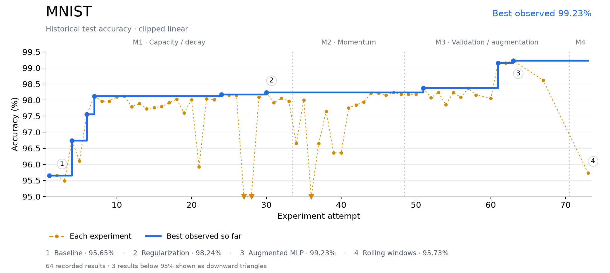
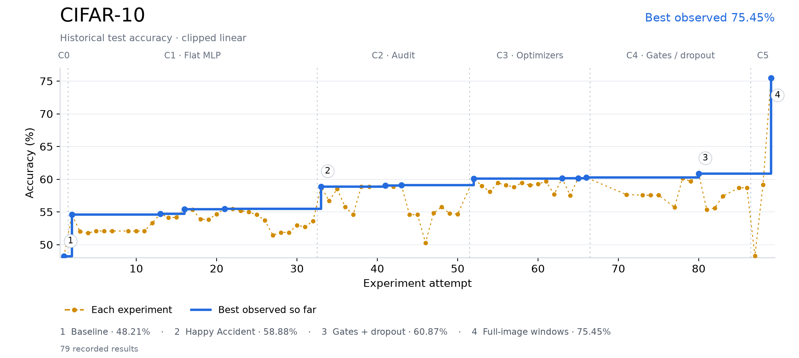
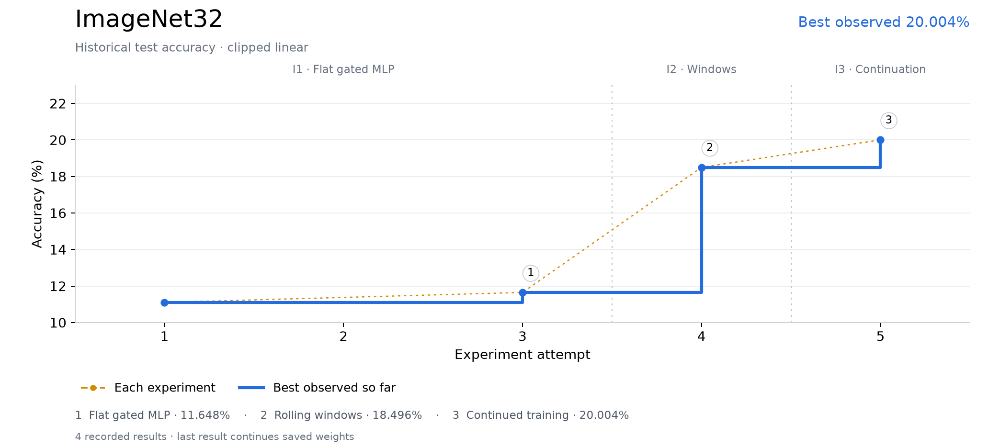

# Development Log — draft

Taylor Turner

Reconstructed from [journal.md](journal.md) and saved experiments. Original wording is reused in quotation marks. Factual descriptions and recorded results are draft scaffolding; `TODO` marks the parts to finish in my own words. Missing predictions have not been invented.

## Before finalizing

- Replace the `TODO` fields. If a prediction or reason is remembered now, label it retrospective; the position of text in the old journal does not establish when it was written.
- Each entry uses **Change / Why / Expected / Result**. Identical saved setups may share an entry; changed model, training or data settings remain separate. Unmatched legacy results need settings or an explicit repeat designation.
- All 109 unique saved run configurations across five worktrees are captured in [the portable evidence snapshot](outputs/experiment-history/all-runs.json), with available model source, metrics and results. [Run index](outputs/experiment-history/run-index.md) links each ID to its evidence and local originals. Earlier module-only snapshots cannot recover missing forward source or activations.
- Early dates follow CSV timestamps where matched. No-run-ID entries use journal settings and identify unresolved discrepancies. Some early CSV columns shifted, so raw rows are preserved and journal values take precedence where stated.
- Test scores below are historical observations. Tuning should use validation; these test observations are not a substitute for a final harness evaluation.
- The era labels and three [draft figures](outputs/experiment-history/figures/README.md) are a working organization, not final conclusions. Gains and regressions can involve multiple changed settings.

## Era figures — design draft

Each task gets one accuracy timeline: a dot for each recorded result, a best-observed step line, and era boundaries. Low outliers are clipped with downward markers. The [interactive preview](outputs/experiment-history/accuracy-preview.html) also offers full-range and log-error scales.

## Baseline reference

### Change 1 — mnist / cifar10 / imagenet32 — 2026-10-15

_Original baseline_

**Change:** Run the supplied baseline: 30 residual blocks, width 128, hidden width 256, tanh, pre-LayerNorm, Xavier initialization and SGD at learning rate 0.05; batch 256. Baseline source: commit `c1f6802`. Configured epochs were MNIST 10, CIFAR-10 30 and ImageNet32 10.

**Why:** “I began by leaving the model architecture unchanged, only changing hyperparameters by hand to understand their impacts.”

**Expected:** TODO — no prediction located. If reconstructing it now, label it retrospective.

**Result:** Earliest CSV results: MNIST 95.65% test in 1.1 minutes; CIFAR-10 48.21% test in 2.0 minutes. The journal’s MNIST baseline rerun records 95.65% in 0.5 minutes. TODO — add the original ImageNet32 baseline result, training-loss observations, and confirmation that these evaluated the unchanged baseline.

**Evidence:** [journal.md](journal.md); legacy CSV line(s) 2, 3, 4 (raw rows retained in the evidence snapshot).

## M1 — Baseline, capacity and regularization

### Change 2 — mnist — 2026-10-19

_Learning rate 0.01_

**Change:** Keep the baseline architecture and 10 epochs; set learning rate to 0.01, seed 42.

**Why:** TODO — add your own reason, based on the evidence you had then.

**Expected:** TODO — no prediction located. If reconstructing it now, label it retrospective.

**Result:** Journal test accuracy 95.49%. Training time 0.6 minutes. TODO — add the loss-curve observation; no per-epoch artifact was located for this early run. TODO — explain whether this matched your expectation.

**Evidence:** [journal.md](journal.md); legacy CSV line(s) 5 (raw rows retained in the evidence snapshot).

### Change 3 — mnist — 2026-10-19

_Learning rate 0.10_

**Change:** Keep the baseline architecture and 10 epochs; set learning rate to 0.10, seed 42.

**Why:** TODO — add your own reason, based on the evidence you had then.

**Expected:** TODO — no prediction located. If reconstructing it now, label it retrospective.

**Result:** Journal test accuracy 96.74%. Training time 0.5 minutes. TODO — add the loss-curve observation; no per-epoch artifact was located for this early run. TODO — explain whether this matched your expectation.

**Evidence:** [journal.md](journal.md); legacy CSV line(s) 6 (raw rows retained in the evidence snapshot).

### Change 4 — mnist — 2026-10-19

_Learning rate 0.15_

**Change:** Keep the baseline architecture and 10 epochs; set learning rate to 0.15, seed 42.

**Why:** TODO — add your own reason, based on the evidence you had then.

**Expected:** TODO — no prediction located. If reconstructing it now, label it retrospective.

**Result:** Journal test accuracy 96.11%. Training time 0.5 minutes. TODO — add the loss-curve observation; no per-epoch artifact was located for this early run. TODO — explain whether this matched your expectation.

**Evidence:** [journal.md](journal.md); legacy CSV line(s) 7 (raw rows retained in the evidence snapshot).

### Change 5 — mnist — 2026-10-19

_50 epochs at learning rate 0.01_

**Change:** Set epochs to 50 and learning rate to 0.01; architecture unchanged.

**Why:** TODO — add your own reason, based on the evidence you had then.

**Expected:** TODO — no prediction located. If reconstructing it now, label it retrospective.

**Result:** Journal test accuracy 97.56%. Training time 2.5 minutes. TODO — add the loss-curve observation; no per-epoch artifact was located for this early run. TODO — explain whether this matched your expectation.

**Evidence:** [journal.md](journal.md); legacy CSV line(s) 8 (raw rows retained in the evidence snapshot).

### Change 6 — mnist — 2026-10-19

_50 epochs at learning rate 0.10_

**Change:** Set epochs to 50 and learning rate to 0.10; architecture unchanged.

**Why:** TODO — add your own reason, based on the evidence you had then.

**Expected:** TODO — no prediction located. If reconstructing it now, label it retrospective.

**Result:** Journal test accuracy 98.12%. Training time 2.4 minutes. TODO — add the loss-curve observation; no per-epoch artifact was located for this early run. TODO — explain whether this matched your expectation.

**Evidence:** [journal.md](journal.md); legacy CSV line(s) 9 (raw rows retained in the evidence snapshot).

### Change 7 — mnist — 2026-10-19

_50 epochs at learning rate 0.15_

**Change:** Set epochs to 50 and learning rate to 0.15; architecture unchanged.

**Why:** TODO — add your own reason, based on the evidence you had then.

**Expected:** TODO — no prediction located. If reconstructing it now, label it retrospective.

**Result:** Journal test accuracy 97.97%. Training time 2.4 minutes. Journal shows loss spikes to 0.5566 and 0.2268 followed by recovery. “We see here lots of big jumps followed by recovery. Not as good as a=0.10.”

**Evidence:** [journal.md](journal.md); legacy CSV line(s) 10 (raw rows retained in the evidence snapshot).

### Change 8 — mnist — 2026-10-19

_Add a training-accuracy check_

**Change:** Measure training accuracy as well as test accuracy for the 50-epoch learning-rate comparisons.

**Why:** “I realized I didn't record train accuracy so I can't compare. Let's understand how train accuracy is looking.”

**Expected:** TODO — no prediction located. If reconstructing it now, label it retrospective.

**Result:** Journal: learning rate 0.05 gave 100.00% train / 98.12% test; 0.10 gave 99.97% / 98.10%; 0.15 gave 99.94% / 97.97%; each took 2.4 minutes. “We see that the baseline learning rate was perfect for this current configuration. All it truly needed was a few more epochs.” TODO — add a loss-curve comparison.

**Evidence:** [journal.md](journal.md); legacy CSV line(s) 11, 12, 13 (raw rows retained in the evidence snapshot).

**Draft notes:** The 0.15 CSV row appears to encode 99.93% train, while the journal says 99.94%. Preserve this discrepancy until checked.

### Change 9 — mnist — 2026-10-19

_40-layer comparison with 25 epochs_

**Change:** Journal records layers=40, epochs=25, seed=42, and `a=0.5`.

**Why:** “After my findings with accuracy revealed that the default learning rate was a solid starting point, I'm ready to move onto layers.”

**Expected:** “Right now I assume the issue is we're losing valuable signal as the layer layers add nothing but noise to an ultimately simple problem. I expect to see some small number of layers, perhaps 10-15 perform the same or better.”

**Result:** Journal test accuracy 97.79%. Training accuracy 99.7%; 1.2 minutes, matching the old row’s shifted layout. TODO — add the loss-curve observation; no per-epoch artifact was located for this early run. TODO — explain whether this matched your expectation.

**Evidence:** [journal.md](journal.md); legacy CSV line(s) 14 (raw rows retained in the evidence snapshot).

**Draft notes:** TODO — verify whether `a=0.5` was a typo for 0.05. The baseline had 30 blocks, while this entry says 40. Do not silently substitute either value.

### Change 10 — mnist — 2026-10-19

_Five layers_

**Change:** Reduce recorded depth from 40 to 5; keep 25 epochs and the preceding setup, subject to its learning-rate uncertainty.

**Why:** TODO — add your own reason, based on the evidence you had then.

**Expected:** “I expect to see some small number of layers, perhaps 10-15 perform the same or better.”

**Result:** Journal test accuracy 97.89%. Training accuracy 99.73%; 0.3 minutes, matching the old row’s shifted layout. TODO — add the loss-curve observation; no per-epoch artifact was located for this early run. “An incredible gain! As predicted we actually see a performance increase by decreasing the layers and a gain of 1.2 minutes”

**Evidence:** [journal.md](journal.md); legacy CSV line(s) 15 (raw rows retained in the evidence snapshot).

**Draft notes:** Journal’s claimed 1.2-minute gain conflicts with the recorded 1.2-to-0.3-minute change (0.9 minutes). TODO — revise the interpretation.

### Change 11 — mnist — 2026-10-19

_1 layers_

**Change:** Set depth to 1; retain the 25-epoch depth-comparison setup.

**Why:** TODO — add your own reason, based on the evidence you had then.

**Expected:** TODO — no prediction located. If reconstructing it now, label it retrospective.

**Result:** Journal test accuracy 97.73%. Training accuracy 99.06%; 0.4 minutes, matching the old row’s shifted layout. TODO — add the loss-curve observation; no per-epoch artifact was located for this early run. TODO — explain whether this matched your expectation.

**Evidence:** [journal.md](journal.md); legacy CSV line(s) 16 (raw rows retained in the evidence snapshot).

### Change 12 — mnist — 2026-10-19

_2 layers_

**Change:** Set depth to 2; retain the 25-epoch depth-comparison setup.

**Why:** TODO — add your own reason, based on the evidence you had then.

**Expected:** TODO — no prediction located. If reconstructing it now, label it retrospective.

**Result:** Journal test accuracy 97.77%. Training accuracy 99.09%; 0.2 minutes, matching the old row’s shifted layout. TODO — add the loss-curve observation; no per-epoch artifact was located for this early run. TODO — explain whether this matched your expectation.

**Evidence:** [journal.md](journal.md); legacy CSV line(s) 17 (raw rows retained in the evidence snapshot).

### Change 13 — mnist — 2026-10-19

_3 layers_

**Change:** Set depth to 3; retain the 25-epoch depth-comparison setup.

**Why:** TODO — add your own reason, based on the evidence you had then.

**Expected:** TODO — no prediction located. If reconstructing it now, label it retrospective.

**Result:** Journal test accuracy 97.8%. Training accuracy 99.57%; 0.3 minutes, matching the old row’s shifted layout. TODO — add the loss-curve observation; no per-epoch artifact was located for this early run. TODO — explain whether this matched your expectation.

**Evidence:** [journal.md](journal.md); legacy CSV line(s) 18 (raw rows retained in the evidence snapshot).

### Change 14 — mnist — 2026-10-19

_4 layers_

**Change:** Set depth to 4; retain the 25-epoch depth-comparison setup.

**Why:** TODO — add your own reason, based on the evidence you had then.

**Expected:** TODO — no prediction located. If reconstructing it now, label it retrospective.

**Result:** Journal test accuracy 97.92%. Training accuracy 99.67%; 0.9 minutes, matching the old row’s shifted layout. Journal’s depth-sweep observation: loss reached the 0.0x range within approximately seven epochs. TODO — explain whether this matched your expectation.

**Evidence:** [journal.md](journal.md); legacy CSV line(s) 19 (raw rows retained in the evidence snapshot).

### Change 15 — mnist — 2026-10-19

_6 layers_

**Change:** Set depth to 6; retain the 25-epoch depth-comparison setup.

**Why:** “For now, let's try a few more until we see a performance regression.”

**Expected:** TODO — no prediction located. If reconstructing it now, label it retrospective.

**Result:** Journal test accuracy 98.03%. Training accuracy 99.79%; 0.4 minutes, matching the old row’s shifted layout. TODO — add the loss-curve observation; no per-epoch artifact was located for this early run. TODO — explain whether this matched your expectation.

**Evidence:** [journal.md](journal.md); legacy CSV line(s) 20 (raw rows retained in the evidence snapshot).

### Change 16 — mnist — 2026-10-19

_7 layers_

**Change:** Set depth to 7; retain the 25-epoch depth-comparison setup.

**Why:** “For now, let's try a few more until we see a performance regression.”

**Expected:** TODO — no prediction located. If reconstructing it now, label it retrospective.

**Result:** Journal test accuracy 97.6%. Training accuracy 99.67%; 0.5 minutes, matching the old row’s shifted layout. TODO — add the loss-curve observation; no per-epoch artifact was located for this early run. “Regression. Let's roll with 6 layers for now. Going to try a run with 50 epochs and 6 layers.”

**Evidence:** [journal.md](journal.md); legacy CSV line(s) 21 (raw rows retained in the evidence snapshot).

### Change 17 — mnist — 2026-10-19

_50 epochs after depth sweep_

**Change:** Set epochs to 50; recorded depth 6, probably actual depth 7.

**Why:** TODO — add your own reason, based on the evidence you had then.

**Expected:** TODO — no prediction located. If reconstructing it now, label it retrospective.

**Result:** Journal test accuracy 98.01%. Training accuracy 100%; 0.9 minutes, matching the old row’s shifted layout. Last four recorded losses: 0.0012, 0.0011, 0.0010, 0.0010. “Zero change in the last epoch. Clearly reached the floor of this configuration.”

**Evidence:** [journal.md](journal.md); legacy CSV line(s) 22 (raw rows retained in the evidence snapshot).

**Draft notes:** The journal records depth 6, but its retrospective correction says these runs probably used 7. Exact transition time is unknown.

### Change 18 — mnist — 2026-10-19

_Residual width 32_

**Change:** Set width=32, hidden=256, epochs=25, learning_rate=0.05; recorded depth 6, probably 7.

**Why:** “My ideas here are to change the size of the residual stream (width) and the size of the hidden layers (hidden).”

**Expected:** “Perhaps a smaller residual stream is equally capable, perhaps a larger residual layer will allow more signal through.”

**Result:** Journal test accuracy 95.92%. Training accuracy 96.93%; 0.4 minutes, matching the old row’s shifted layout. “Immediately slower training. Didn't reach 0.0# until epoch 18.” TODO — explain whether this matched your expectation.

**Evidence:** [journal.md](journal.md); legacy CSV line(s) 23 (raw rows retained in the evidence snapshot).

**Draft notes:** The journal records depth 6, but its retrospective correction says these runs probably used 7. Exact transition time is unknown.

### Change 19 — mnist — 2026-10-19

_Residual width 256_

**Change:** Set width=256, hidden=256, epochs=25, learning_rate=0.05; recorded depth 6, probably 7.

**Why:** TODO — add your own reason, based on the evidence you had then.

**Expected:** “perhaps a larger residual layer will allow more signal through.”

**Result:** Journal test accuracy 98.04%. Training accuracy 99.99%; 0.5 minutes, matching the old row’s shifted layout. Journal: loss reached the 0.0x range in six epochs. “Incredible training accuracy but a trivial improvement in test. All we did was improve the models ability to overfit.”

**Evidence:** [journal.md](journal.md); legacy CSV line(s) 24 (raw rows retained in the evidence snapshot).

**Draft notes:** The journal records depth 6, but its retrospective correction says these runs probably used 7. Exact transition time is unknown.

### Change 20 — mnist — 2026-10-19

_50 epochs at width 256_

**Change:** Keep width=256 and hidden=256; extend training from 25 to 50 epochs.

**Why:** “Let's try a 50 epoch here since I see a bit more room for training loss.”

**Expected:** TODO — no prediction located. If reconstructing it now, label it retrospective.

**Result:** Journal test accuracy 98.01%. Training accuracy 100%; 0.9 minutes, matching the old row’s shifted layout. TODO — add the loss-curve observation; no per-epoch artifact was located for this early run. “We gained an incredible -0.03%. I'd say that was just further overfitting pushing our performance worse.”

**Evidence:** [journal.md](journal.md); legacy CSV line(s) 25 (raw rows retained in the evidence snapshot).

**Draft notes:** The journal records depth 6, but its retrospective correction says these runs probably used 7. Exact transition time is unknown.

### Change 21 — mnist — 2026-10-19

_Hidden width 512_

**Change:** Set width=256, hidden=512, epochs=50, learning_rate=0.05; recorded depth 6, probably 7.

**Why:** “For now, let's see what happens when we tinker with the size of the hidden layers. Perhaps reducing the models capacity will serve a similar role.”

**Expected:** TODO — no prediction located. If reconstructing it now, label it retrospective.

**Result:** Journal test accuracy 98.17%. Training accuracy 100%; 1.0 minutes, matching the old row’s shifted layout. TODO — add the loss-curve observation; no per-epoch artifact was located for this early run. TODO — explain whether this matched your expectation.

**Evidence:** [journal.md](journal.md); legacy CSV line(s) 26 (raw rows retained in the evidence snapshot).

**Draft notes:** The journal records depth 6, but its retrospective correction says these runs probably used 7. Exact transition time is unknown. Journal settings increase hidden width, although the preceding idea mentions reducing capacity. TODO — explain the intended comparison. The printed result is 98.17%, while the following sentence says 98.18%.

### Change 22 — mnist — 2026-10-19

_Residual width 512_

**Change:** Set width=512, hidden=512, epochs=50, learning_rate=0.05; recorded depth 6, probably 7.

**Why:** TODO — add your own reason, based on the evidence you had then.

**Expected:** TODO — no prediction located. If reconstructing it now, label it retrospective.

**Result:** Journal test accuracy 98.16%. Training accuracy 100%; 1.1 minutes, matching the old row’s shifted layout. TODO — add the loss-curve observation; no per-epoch artifact was located for this early run. TODO — explain whether this matched your expectation.

**Evidence:** [journal.md](journal.md); legacy CSV line(s) 27 (raw rows retained in the evidence snapshot).

**Draft notes:** The journal records depth 6, but its retrospective correction says these runs probably used 7. Exact transition time is unknown.

### Change 23 — mnist — 2026-10-19

_Hidden width 1024_

**Change:** Set width=512, hidden=1024, epochs=50, learning_rate=0.05; recorded depth 6, probably 7.

**Why:** TODO — add your own reason, based on the evidence you had then.

**Expected:** TODO — no prediction located. If reconstructing it now, label it retrospective.

**Result:** Journal test accuracy 98.15%. Training accuracy 100%; 1.4 minutes, matching the old row’s shifted layout. TODO — add the loss-curve observation; no per-epoch artifact was located for this early run. “Crazy experiments over with no real change. This is obviously a dead end. Onto Regularization.”

**Evidence:** [journal.md](journal.md); legacy CSV line(s) 28 (raw rows retained in the evidence snapshot).

**Draft notes:** The journal records depth 6, but its retrospective correction says these runs probably used 7. Exact transition time is unknown.

### Change 24 — mnist — 2026-10-19

_Weight decay 0.99_

**Change:** Restore width=256 and hidden=512; set weight_decay=0.99, learning_rate=0.05, epochs=50; recorded depth 6, probably 7.

**Why:** “Weight decay is a classic from ML. Let's try to force down those worthless weights and see if we can open up some capacity for the test accuracy to use.”

**Expected:** TODO — no prediction located. If reconstructing it now, label it retrospective.

**Result:** Journal test accuracy 11.35%. Training accuracy 11.24%; 1.0 minutes, matching the old row’s shifted layout. Journal: loss changed by only about 0.0001 across 50 epochs. “Didn't learn a thing.”

**Evidence:** [journal.md](journal.md); legacy CSV line(s) 29 (raw rows retained in the evidence snapshot).

**Draft notes:** The journal records depth 6, but its retrospective correction says these runs probably used 7. Exact transition time is unknown. TODO — explain the SGD weight-decay update correctly. Weight decay 0.99 is not “99% of squared magnitude allowed to affect weight decay.”

### Change 25 — mnist — 2026-10-19

_Weight decay 0.01_

**Change:** Reduce weight_decay from 0.99 to 0.01; set epochs=25; width=256, hidden=512, learning_rate=0.05.

**Why:** TODO — add your own reason, based on the evidence you had then.

**Expected:** TODO — no prediction located. If reconstructing it now, label it retrospective.

**Result:** Journal test accuracy 87.79%. Training accuracy 86.78%; 0.5 minutes, matching the old row’s shifted layout. TODO — add the loss-curve observation; no per-epoch artifact was located for this early run. TODO — explain whether this matched your expectation.

**Evidence:** [journal.md](journal.md); legacy CSV line(s) 30 (raw rows retained in the evidence snapshot).

**Draft notes:** The journal records depth 6, but its retrospective correction says these runs probably used 7. Exact transition time is unknown.

### Change 26 — mnist — 2026-10-19

_Weight decay 0.0001_

**Change:** Set weight_decay=0.0001; keep 25 epochs, width=256, hidden=512, learning_rate=0.05.

**Why:** “Let's try suggestion from the internet, 1e-4.”

**Expected:** TODO — no prediction located. If reconstructing it now, label it retrospective.

**Result:** Journal test accuracy 98.09%. Training accuracy 99.96%; 0.5 minutes, matching the old row’s shifted layout. Recorded losses at epochs 22–25: 0.0093, 0.0077, 0.0060, 0.0047. TODO — explain whether this matched your expectation.

**Evidence:** [journal.md](journal.md); legacy CSV line(s) 31 (raw rows retained in the evidence snapshot).

**Draft notes:** The journal records depth 6, but its retrospective correction says these runs probably used 7. Exact transition time is unknown. TODO — identify and cite the source of the weight-decay suggestion if you remember it.

### Change 27 — mnist — 2026-10-19

_50 epochs with weight decay 0.0001_

**Change:** Extend the regularized configuration to 50 epochs; width=256, hidden=512, learning_rate=0.05.

**Why:** “This is interesting, we're almost back where we started but we still have a little wiggle room with train accuracy. I still see some more downward motion in the loss as well.”

**Expected:** TODO — no prediction located. If reconstructing it now, label it retrospective.

**Result:** Journal test accuracy 98.24%. Training accuracy 100%; 1.0 minutes, matching the old row’s shifted layout. TODO — add the loss-curve observation; no per-epoch artifact was located for this early run. “The plan paid off! We closed the train accuracy to 100% again and gained 0.10 of test accuracy.”

**Evidence:** [journal.md](journal.md); legacy CSV line(s) 32 (raw rows retained in the evidence snapshot).

**Draft notes:** The journal records depth 6, but its retrospective correction says these runs probably used 7. Exact transition time is unknown.

### Change 28 — mnist — 2026-10-19

_Weight decay 0.001_

**Change:** Increase weight_decay to 0.001; keep 50 epochs, width=256, hidden=512, learning_rate=0.05.

**Why:** TODO — add your own reason, based on the evidence you had then.

**Expected:** TODO — no prediction located. If reconstructing it now, label it retrospective.

**Result:** Journal test accuracy 97.92%. Training accuracy 99.27%; 1.0 minutes, matching the old row’s shifted layout. Journal reports oscillation. “Tried another jump in regularization and I'm starting to see a lot of oscillation. We've lost test accuracy in exchange for some train room.”

**Evidence:** [journal.md](journal.md); legacy CSV line(s) 33 (raw rows retained in the evidence snapshot).

**Draft notes:** The journal records depth 6, but its retrospective correction says these runs probably used 7. Exact transition time is unknown.

### Change 29 — mnist — 2026-10-19

_Learning rate 0.03 with decay 0.001_

**Change:** Set learning_rate=0.03; weight_decay=0.001, epochs=50, width=256, hidden=512.

**Why:** “We've lost test accuracy in exchange for some train room. Let me try a smaller learning rate.”

**Expected:** TODO — no prediction located. If reconstructing it now, label it retrospective.

**Result:** Journal test accuracy 98.06%. Training accuracy 99.66%; 1.0 minutes, matching the old row’s shifted layout. TODO — add the loss-curve observation; no per-epoch artifact was located for this early run. “a=0.03 worked. I saw oscillation happening and it predictably solved it.”

**Evidence:** [journal.md](journal.md); legacy CSV line(s) 34 (raw rows retained in the evidence snapshot).

**Draft notes:** The journal records depth 6, but its retrospective correction says these runs probably used 7. Exact transition time is unknown.

### Change 30 — mnist — 2026-10-19

_Learning rate 0.01 with decay 0.001_

**Change:** Set learning_rate=0.01; weight_decay=0.001, epochs=50, width=256, hidden=512.

**Why:** TODO — add your own reason, based on the evidence you had then.

**Expected:** TODO — no prediction located. If reconstructing it now, label it retrospective.

**Result:** Journal test accuracy 97.97%. Training accuracy 99.91%; 1.0 minutes, matching the old row’s shifted layout. “With 0.01 we're seeing incredibly slow training with more room for training by epoch 50.” TODO — explain whether this matched your expectation.

**Evidence:** [journal.md](journal.md); legacy CSV line(s) 35 (raw rows retained in the evidence snapshot).

**Draft notes:** The journal records depth 6, but its retrospective correction says these runs probably used 7. Exact transition time is unknown.

## M2 — Momentum and depth corrections

### Change 31 — mnist — 2026-10-20

_SGD momentum 0.9_

**Change:** Set momentum=0.9; learning_rate=0.01, weight_decay=0.001, epochs=50, width=256, hidden=512.

**Why:** “We're already using SGD, I have no interest in trying classical GD due to time and probable worse performance. So, let's try just adding some momentum and see what happens.”

**Expected:** TODO — no prediction located. If reconstructing it now, label it retrospective.

**Result:** Journal test accuracy 96.66%. Training accuracy 98.25%; 1.1 minutes, matching the old row’s shifted layout. TODO — add the loss-curve observation; no per-epoch artifact was located for this early run. “Well that didn't work. Let's try less.”

**Evidence:** [journal.md](journal.md); legacy CSV line(s) 36 (raw rows retained in the evidence snapshot).

**Draft notes:** The journal records depth 6, but its retrospective correction says these runs probably used 7. Exact transition time is unknown.

### Change 32 — mnist — 2026-10-20

_SGD momentum 0.5_

**Change:** Reduce momentum to 0.5; keep learning_rate=0.01, weight_decay=0.001, epochs=50, width=256, hidden=512.

**Why:** TODO — add your own reason, based on the evidence you had then.

**Expected:** TODO — no prediction located. If reconstructing it now, label it retrospective.

**Result:** Journal test accuracy 98%. Training accuracy 100%; 1.1 minutes, matching the old row’s shifted layout. TODO — add the loss-curve observation; no per-epoch artifact was located for this early run. TODO — explain whether this matched your expectation.

**Evidence:** [journal.md](journal.md); legacy CSV line(s) 37 (raw rows retained in the evidence snapshot).

**Draft notes:** The journal records depth 6, but its retrospective correction says these runs probably used 7. Exact transition time is unknown.

### Change 33 — mnist — 2026-10-20

_Weight decay 0.005 with momentum 0.5_

**Change:** Set weight_decay=0.005; momentum=0.5, learning_rate=0.01, epochs=50, width=256, hidden=512.

**Why:** “Well that kinda worked. Maybe more regularization?”

**Expected:** TODO — no prediction located. If reconstructing it now, label it retrospective.

**Result:** Journal test accuracy 94.08%. Training accuracy 94.67%; 1.1 minutes, matching the old row’s shifted layout. TODO — add the loss-curve observation; no per-epoch artifact was located for this early run. “Huge overshoot. Let's try less momentum then bring in dampening. Could also try a smaller learning rate.”

**Evidence:** [journal.md](journal.md); legacy CSV line(s) 38 (raw rows retained in the evidence snapshot).

**Draft notes:** The journal records depth 6, but its retrospective correction says these runs probably used 7. Exact transition time is unknown.

### Change 34 — mnist — 2026-10-20

_Momentum 0.3 with decay 0.005_

**Change:** Set momentum=0.3; weight_decay=0.005, batch=256, learning_rate=0.01, epochs=50, width=256, hidden=512.

**Why:** TODO — add your own reason, based on the evidence you had then.

**Expected:** TODO — no prediction located. If reconstructing it now, label it retrospective.

**Result:** Journal test accuracy 96.65%. Training accuracy 97.73%; 1.1 minutes, matching the old row’s shifted layout. TODO — add the loss-curve observation; no per-epoch artifact was located for this early run. TODO — explain whether this matched your expectation.

**Evidence:** [journal.md](journal.md); legacy CSV line(s) 39 (raw rows retained in the evidence snapshot).

**Draft notes:** The journal records depth 6, but its retrospective correction says these runs probably used 7. Exact transition time is unknown.

### Change 35 — mnist — 2026-10-20

_Batch 128 and weight decay 0.001_

**Change:** Set batch=128 and weight_decay=0.001; momentum=0.3, learning_rate=0.01, epochs=50, width=256, hidden=512.

**Why:** “Doing something else as a waiting move. Changing weight decay back down and turning down batch size so it must generalize more.”

**Expected:** TODO — no prediction located. If reconstructing it now, label it retrospective.

**Result:** Journal test accuracy 96.36%. Training accuracy 98.41%; 2.0 minutes, matching the old row’s shifted layout. “Still oscillating.” TODO — explain whether this matched your expectation.

**Evidence:** [journal.md](journal.md); legacy CSV line(s) 42 (raw rows retained in the evidence snapshot).

**Draft notes:** The journal records depth 6, but its retrospective correction says these runs probably used 7. Exact transition time is unknown. The nearby CSV-only result at 11:42 is not assigned this setup because the journal does not identify it.

### Change 36 — mnist — 2026-10-20

_Learning rate 0.001 and momentum 0.9_

**Change:** Set learning_rate=0.001 and momentum=0.9; batch=256, weight_decay=0.001, epochs=50, width=256, hidden=512.

**Why:** “https://distill.pub/2017/momentum/ This post opened my eyes. Let's experiment. Maybe our learning rate is too high? Let's try more momentum, less learning rate.”

**Expected:** TODO — no prediction located. If reconstructing it now, label it retrospective.

**Result:** Journal test accuracy 97.76%. Training accuracy 99.96%; 1.2 minutes, matching the old row’s shifted layout. TODO — add the loss-curve observation; no per-epoch artifact was located for this early run. “Slow training, okay results.”

**Evidence:** [journal.md](journal.md); legacy CSV line(s) 43 (raw rows retained in the evidence snapshot).

**Draft notes:** The journal records depth 6, but its retrospective correction says these runs probably used 7. Exact transition time is unknown.

### Change 37 — mnist — 2026-10-20

_Batch 128 at learning rate 0.001_

**Change:** Reduce batch to 128; learning_rate=0.001, momentum=0.9, weight_decay=0.001, epochs=50, width=256, hidden=512.

**Why:** “Slow training, okay results. More batch to make more little jumps?”

**Expected:** TODO — no prediction located. If reconstructing it now, label it retrospective.

**Result:** Journal test accuracy 97.85%. Training accuracy 99.93%; 2.0 minutes, matching the old row’s shifted layout. “Faster convergence, seeing some oscillation.” TODO — explain whether this matched your expectation.

**Evidence:** [journal.md](journal.md); legacy CSV line(s) 44 (raw rows retained in the evidence snapshot).

**Draft notes:** The journal records depth 6, but its retrospective correction says these runs probably used 7. Exact transition time is unknown. TODO — revise the explanation: a smaller batch means more optimizer updates per epoch, not a larger batch.

### Change 38 — mnist — 2026-10-20

_Learning rate 0.0001_

**Change:** Set learning_rate=0.0001; batch=128, momentum=0.9, weight_decay=0.001, epochs=50, width=256, hidden=512.

**Why:** TODO — add your own reason, based on the evidence you had then.

**Expected:** TODO — no prediction located. If reconstructing it now, label it retrospective.

**Result:** Journal test accuracy 97.94%. Training accuracy 100%; 2.9 minutes, matching the old row’s shifted layout. TODO — add the loss-curve observation; no per-epoch artifact was located for this early run. TODO — explain whether this matched your expectation.

**Evidence:** [journal.md](journal.md); legacy CSV line(s) 45 (raw rows retained in the evidence snapshot).

**Draft notes:** The journal records depth 6, but its retrospective correction says these runs probably used 7. Exact transition time is unknown.

### Change 39 — mnist — 2026-10-20

_Accidental weight decay 0.00001_

**Change:** Set depth=7, width=256, hidden=512, batch=256, learning_rate=0.05, epochs=50; accidentally enter weight_decay=0.1e-4 (=0.00001).

**Why:** TODO — add your own reason, based on the evidence you had then.

**Expected:** TODO — no prediction located. If reconstructing it now, label it retrospective.

**Result:** Journal test accuracy 98.22%. Training accuracy 100%; 1.0 minutes, matching the old row’s shifted layout. TODO — add the loss-curve observation; no per-epoch artifact was located for this early run. “I actually made a mistake, I forgot to remove the 0. before the 1 in weight_decay and I got this 98.22%.”

**Evidence:** [journal.md](journal.md); legacy CSV line(s) 47 (raw rows retained in the evidence snapshot).

**Draft notes:** The preceding 12:08 CSV result also scored 98.22%, but its settings are not independently recorded. It remains in the unresolved list.

### Change 40 — mnist — 2026-10-20

_Correct decay to 0.0001_

**Change:** Keep depth=7, width=256, hidden=512, batch=256, learning_rate=0.05, epochs=50; set weight_decay=0.0001.

**Why:** TODO — add your own reason, based on the evidence you had then.

**Expected:** TODO — no prediction located. If reconstructing it now, label it retrospective.

**Result:** Journal test accuracy 98.16%. Training accuracy 100%; 0.9 minutes, matching the old row’s shifted layout. TODO — add the loss-curve observation; no per-epoch artifact was located for this early run. TODO — explain whether this matched your expectation.

**Evidence:** [journal.md](journal.md); legacy CSV line(s) 48 (raw rows retained in the evidence snapshot).

### Change 41 — mnist — 2026-10-20

_Explicitly test depth 6_

**Change:** Change depth from 7 to 6; width=256, hidden=512, batch=256, learning_rate=0.05, epochs=50, weight_decay=0.0001.

**Why:** TODO — add your own reason, based on the evidence you had then.

**Expected:** TODO — no prediction located. If reconstructing it now, label it retrospective.

**Result:** Journal test accuracy 98.24%. Training accuracy 100%; 1.0 minutes, matching the old row’s shifted layout. TODO — add the loss-curve observation; no per-epoch artifact was located for this early run. TODO — explain whether this matched your expectation.

**Evidence:** [journal.md](journal.md); legacy CSV line(s) 49 (raw rows retained in the evidence snapshot).

**Draft notes:** Later retrospective replay evidence in the journal associates 98.24% with seven blocks and 98.16% with six. These contemporary labels say the reverse. TODO — reconcile; do not silently relabel either historical result.

### Change 42 — mnist — 2026-10-20

_Unmatched legacy result at 11:42_

**Change:** TODO — identify the changed setup or mark this as a repeat of another entry. No run directory or exact configuration was saved with this row.

**Why:** TODO — add your own reason, based on the evidence you had then.

**Expected:** TODO — no prediction located. If reconstructing it now, label it retrospective.

**Result:** CSV records 97.65% test accuracy. The CSV column layout is shifted; printed time/train values require review. TODO — add confirmed training time, train accuracy, loss behavior and interpretation.

**Evidence:** [journal.md](journal.md); legacy CSV line(s) 40 (raw rows retained in the evidence snapshot).

### Change 43 — mnist — 2026-10-20

_Unmatched legacy result at 11:44_

**Change:** TODO — identify the changed setup or mark this as a repeat of another entry. No run directory or exact configuration was saved with this row.

**Why:** TODO — add your own reason, based on the evidence you had then.

**Expected:** TODO — no prediction located. If reconstructing it now, label it retrospective.

**Result:** CSV records 96.36% test accuracy. The CSV column layout is shifted; printed time/train values require review. TODO — add confirmed training time, train accuracy, loss behavior and interpretation.

**Evidence:** [journal.md](journal.md); legacy CSV line(s) 41 (raw rows retained in the evidence snapshot).

### Change 44 — mnist — 2026-10-20

_Unmatched legacy result at 12:08_

**Change:** TODO — identify the changed setup or mark this as a repeat of another entry. No run directory or exact configuration was saved with this row.

**Why:** TODO — add your own reason, based on the evidence you had then.

**Expected:** TODO — no prediction located. If reconstructing it now, label it retrospective.

**Result:** CSV records 98.22% test accuracy. The CSV column layout is shifted; printed time/train values require review. TODO — add confirmed training time, train accuracy, loss behavior and interpretation.

**Evidence:** [journal.md](journal.md); legacy CSV line(s) 46 (raw rows retained in the evidence snapshot).

### Change 45 — mnist — 2026-10-20

_Unmatched legacy result at 12:40_

**Change:** TODO — identify the changed setup or mark this as a repeat of another entry. No run directory or exact configuration was saved with this row.

**Why:** TODO — add your own reason, based on the evidence you had then.

**Expected:** TODO — no prediction located. If reconstructing it now, label it retrospective.

**Result:** CSV records 98.18% test accuracy. The CSV column layout is shifted; printed time/train values require review. TODO — add confirmed training time, train accuracy, loss behavior and interpretation.

**Evidence:** [journal.md](journal.md); legacy CSV line(s) 50 (raw rows retained in the evidence snapshot).

## M3 — Longer training, validation and augmentation

### Change 46 — mnist — 2026-10-22

_Unmatched legacy result at 14:49_

**Change:** TODO — identify the changed setup or mark this as a repeat of another entry. No run directory or exact configuration was saved with this row.

**Why:** TODO — add your own reason, based on the evidence you had then.

**Expected:** TODO — no prediction located. If reconstructing it now, label it retrospective.

**Result:** CSV records 98.18% test accuracy. The CSV column layout is shifted; printed time/train values require review. TODO — add confirmed training time, train accuracy, loss behavior and interpretation.

**Evidence:** [journal.md](journal.md); legacy CSV line(s) 51 (raw rows retained in the evidence snapshot).

### Change 47 — mnist — 2026-10-22

_Unmatched legacy result at 14:54_

**Change:** TODO — identify the changed setup or mark this as a repeat of another entry. No run directory or exact configuration was saved with this row.

**Why:** TODO — add your own reason, based on the evidence you had then.

**Expected:** TODO — no prediction located. If reconstructing it now, label it retrospective.

**Result:** CSV records 98.18% test accuracy. The CSV column layout is shifted; printed time/train values require review. TODO — add confirmed training time, train accuracy, loss behavior and interpretation.

**Evidence:** [journal.md](journal.md); legacy CSV line(s) 52 (raw rows retained in the evidence snapshot).

### Change 48 — mnist — 2026-10-22

_Unmatched legacy result at 15:33_

**Change:** TODO — identify the changed setup or mark this as a repeat of another entry. No run directory or exact configuration was saved with this row.

**Why:** TODO — add your own reason, based on the evidence you had then.

**Expected:** TODO — no prediction located. If reconstructing it now, label it retrospective.

**Result:** CSV records 98.37% test accuracy. The CSV column layout is shifted; printed time/train values require review. TODO — add confirmed training time, train accuracy, loss behavior and interpretation.

**Evidence:** [journal.md](journal.md); legacy CSV line(s) 53 (raw rows retained in the evidence snapshot).

### Change 49 — mnist — 2026-10-22

_Unmatched legacy result at 17:30_

**Change:** TODO — identify the changed setup or mark this as a repeat of another entry. No run directory or exact configuration was saved with this row.

**Why:** TODO — add your own reason, based on the evidence you had then.

**Expected:** TODO — no prediction located. If reconstructing it now, label it retrospective.

**Result:** CSV records 98.07% test accuracy. The CSV column layout is shifted; printed time/train values require review. TODO — add confirmed training time, train accuracy, loss behavior and interpretation.

**Evidence:** [journal.md](journal.md); legacy CSV line(s) 54 (raw rows retained in the evidence snapshot).

### Change 50 — mnist — 2026-10-22

_Unmatched legacy result at 17:38_

**Change:** TODO — identify the changed setup or mark this as a repeat of another entry. No run directory or exact configuration was saved with this row.

**Why:** TODO — add your own reason, based on the evidence you had then.

**Expected:** TODO — no prediction located. If reconstructing it now, label it retrospective.

**Result:** CSV records 98.24% test accuracy. The CSV column layout is shifted; printed time/train values require review. TODO — add confirmed training time, train accuracy, loss behavior and interpretation.

**Evidence:** [journal.md](journal.md); legacy CSV line(s) 55 (raw rows retained in the evidence snapshot).

### Change 51 — mnist — 2026-10-22

_Unmatched legacy result at 17:48_

**Change:** TODO — identify the changed setup or mark this as a repeat of another entry. No run directory or exact configuration was saved with this row.

**Why:** TODO — add your own reason, based on the evidence you had then.

**Expected:** TODO — no prediction located. If reconstructing it now, label it retrospective.

**Result:** CSV records 97.86% test accuracy. The CSV column layout is shifted; printed time/train values require review. TODO — add confirmed training time, train accuracy, loss behavior and interpretation.

**Evidence:** [journal.md](journal.md); legacy CSV line(s) 56 (raw rows retained in the evidence snapshot).

### Change 52 — mnist — 2026-10-22

_Unmatched legacy result at 17:49_

**Change:** TODO — identify the changed setup or mark this as a repeat of another entry. No run directory or exact configuration was saved with this row.

**Why:** TODO — add your own reason, based on the evidence you had then.

**Expected:** TODO — no prediction located. If reconstructing it now, label it retrospective.

**Result:** CSV records 98.24% test accuracy. The CSV column layout is shifted; printed time/train values require review. TODO — add confirmed training time, train accuracy, loss behavior and interpretation.

**Evidence:** [journal.md](journal.md); legacy CSV line(s) 57 (raw rows retained in the evidence snapshot).

### Change 53 — mnist — 2026-10-22

_Unmatched legacy result at 21:34_

**Change:** TODO — identify the changed setup or mark this as a repeat of another entry. No run directory or exact configuration was saved with this row.

**Why:** TODO — add your own reason, based on the evidence you had then.

**Expected:** TODO — no prediction located. If reconstructing it now, label it retrospective.

**Result:** CSV records 98.09% test accuracy. The CSV column layout is shifted; printed time/train values require review. TODO — add confirmed training time, train accuracy, loss behavior and interpretation.

**Evidence:** [journal.md](journal.md); legacy CSV line(s) 58 (raw rows retained in the evidence snapshot).

### Change 54 — mnist — 2026-10-22

_Unmatched legacy result at 21:47_

**Change:** TODO — identify the changed setup or mark this as a repeat of another entry. No run directory or exact configuration was saved with this row.

**Why:** TODO — add your own reason, based on the evidence you had then.

**Expected:** TODO — no prediction located. If reconstructing it now, label it retrospective.

**Result:** CSV records 98.37% test accuracy. The CSV column layout is shifted; printed time/train values require review. TODO — add confirmed training time, train accuracy, loss behavior and interpretation.

**Evidence:** [journal.md](journal.md); legacy CSV line(s) 59 (raw rows retained in the evidence snapshot).

### Change 55 — mnist — 2026-10-22

_Validation-based checkpoint selection_

**Change:** legacy MLP (module shapes saved; forward source not captured). Exact module shapes are in the saved configuration; activation and forward source were not captured. Optimizer=not recorded, lr=0.05, weight_decay=0.0001, batch=256, epochs=500, seed=42; augmentation=not recorded. Other optimizer, split and augmentation settings are preserved in the evidence snapshot.

**Why:** “When I implemented augmentation, I used Codex and it made an executive decision I was initially confused by. It created a train/test/validation split.”

**Expected:** TODO — no prediction located. If reconstructing it now, label it retrospective.

**Result:** `mnist-20261022-220617-e4881f95`: train 100%, validation 98.48%, test 98.16%; 9.10 minutes; selected epoch 368. Train loss 0.6946 to 0.0002703; minimum 0.0002227 at epoch 278; validation loss 0.3219 to 0.07032; minimum 0.05885 at epoch 358.

TODO — add your own interpretation and whether the result matched your expectation.

**Runs:** [mnist-20261022-220617-e4881f95](outputs/experiment-history/run-index.md#mnist-20261022-220617-e4881f95).

**Draft notes:** Legacy snapshot: activation/forward code is missing. Do not infer it from a later restored version.

### Change 56 — mnist — 2026-10-22

_Legacy mlp (module shapes saved; forward source not captured)_

**Change:** legacy MLP (module shapes saved; forward source not captured). Exact module shapes are in the saved configuration; activation and forward source were not captured. Optimizer=not recorded, lr=0.01, weight_decay=0.0001, batch=256, epochs=1000, seed=42; augmentation=not recorded. Other optimizer, split and augmentation settings are preserved in the evidence snapshot.

**Why:** TODO — add your own reason, based on the evidence you had then.

**Expected:** TODO — no prediction located. If reconstructing it now, label it retrospective.

**Result:** `mnist-20261022-230308-ed671f61`: No final score; 143 completed epoch rows saved. Train loss 0.6247 to 0.000658; minimum 0.000658 at epoch 143; validation loss 0.3862 to 0.09722; minimum 0.08053 at epoch 42.

TODO — add your own interpretation and whether the result matched your expectation.

**Runs:** [mnist-20261022-230308-ed671f61](outputs/experiment-history/run-index.md#mnist-20261022-230308-ed671f61).

**Draft notes:** Legacy snapshot: activation/forward code is missing. Do not infer it from a later restored version.

### Change 57 — mnist — 2026-10-22

_Legacy mlp (module shapes saved; forward source not captured)_

**Change:** legacy MLP (module shapes saved; forward source not captured). Exact module shapes are in the saved configuration; activation and forward source were not captured. Optimizer=not recorded, lr=0.03, weight_decay=0.0001, batch=256, epochs=1000, seed=42; augmentation=not recorded. Other optimizer, split and augmentation settings are preserved in the evidence snapshot.

**Why:** TODO — add your own reason, based on the evidence you had then.

**Expected:** TODO — no prediction located. If reconstructing it now, label it retrospective.

**Result:** `mnist-20261022-230552-e687600f`: train 100%, validation 98.42%, test 98.06%; 18.50 minutes; selected epoch 653. Train loss 0.5453 to 0.000259; minimum 0.0002077 at epoch 341; validation loss 0.3552 to 0.08314; minimum 0.06415 at epoch 615.

TODO — add your own interpretation and whether the result matched your expectation.

**Runs:** [mnist-20261022-230552-e687600f](outputs/experiment-history/run-index.md#mnist-20261022-230552-e687600f).

**Draft notes:** Legacy snapshot: activation/forward code is missing. Do not infer it from a later restored version.

### Change 58 — mnist — 2026-10-23

_MNIST data augmentation_

**Change:** legacy MLP (module shapes saved; forward source not captured). Exact module shapes are in the saved configuration; activation and forward source were not captured. Optimizer=not recorded, lr=0.05, weight_decay=0.0001, batch=256, epochs=400, seed=42; augmentation=True. Other optimizer, split and augmentation settings are preserved in the evidence snapshot.

**Why:** “Then, also building from what we did in class I decided to add data augmentation. Move the image around, blur it, brighten it, etc.”

**Expected:** TODO — no prediction located. If reconstructing it now, label it retrospective.

**Result:** `mnist-20261023-001324-8a4087e7`: train 99.97%, validation 99.32%, test 99.15%; 13.70 minutes; selected epoch 315. Train loss 1.095 to 0.01925; minimum 0.0156 at epoch 357; validation loss 0.4271 to 0.02562; minimum 0.02282 at epoch 323.

TODO — add your own interpretation and whether the result matched your expectation.

**Runs:** [mnist-20261023-001324-8a4087e7](outputs/experiment-history/run-index.md#mnist-20261023-001324-8a4087e7).

**Draft notes:** Legacy snapshot: activation/forward code is missing. Do not infer it from a later restored version. Journal later mentions 99.32% at epoch 384. This run records 99.32% validation, 99.15% test and selected epoch 315. TODO — identify the intended run/metric; do not treat these as the same observation.

### Change 59 — mnist — 2026-10-23

_Legacy mlp (module shapes saved; forward source not captured)_

**Change:** legacy MLP (module shapes saved; forward source not captured). Exact module shapes are in the saved configuration; activation and forward source were not captured. Optimizer=not recorded, lr=0.05, weight_decay=0.0001, batch=256, epochs=500, seed=42; augmentation=True. Other optimizer, split and augmentation settings are preserved in the evidence snapshot.

**Why:** TODO — add your own reason, based on the evidence you had then.

**Expected:** TODO — no prediction located. If reconstructing it now, label it retrospective.

**Result:** `mnist-20261023-100855-d6864421`: train 99.97%, validation 99.32%, test 99.15%; 17.40 minutes; selected epoch 315. Train loss 1.095 to 0.01711; minimum 0.0156 at epoch 357; validation loss 0.4271 to 0.02901; minimum 0.02282 at epoch 323.

TODO — add your own interpretation and whether the result matched your expectation.

**Runs:** [mnist-20261023-100855-d6864421](outputs/experiment-history/run-index.md#mnist-20261023-100855-d6864421).

**Draft notes:** Legacy snapshot: activation/forward code is missing. Do not infer it from a later restored version.

### Change 60 — mnist — 2026-10-23

_Legacy mlp (module shapes saved; forward source not captured)_

**Change:** legacy MLP (module shapes saved; forward source not captured). Exact module shapes are in the saved configuration; activation and forward source were not captured. Optimizer=not recorded, lr=0.05, weight_decay=0.0001, batch=256, epochs=500, seed=42; augmentation=True. Other optimizer, split and augmentation settings are preserved in the evidence snapshot.

**Why:** TODO — add your own reason, based on the evidence you had then.

**Expected:** TODO — no prediction located. If reconstructing it now, label it retrospective.

**Result:** `mnist-20261023-105208-872d486e`: train 100%, validation 99.33%, test 99.23%; 17.30 minutes; selected epoch 317. Train loss 0.7405 to 0.01587; minimum 0.01001 at epoch 357; validation loss 0.207 to 0.02676; minimum 0.02371 at epoch 481.

TODO — add your own interpretation and whether the result matched your expectation.

**Runs:** [mnist-20261023-105208-872d486e](outputs/experiment-history/run-index.md#mnist-20261023-105208-872d486e).

**Draft notes:** Legacy snapshot: activation/forward code is missing. Do not infer it from a later restored version.

### Change 61 — mnist — 2026-10-23

_Legacy mlp (module shapes saved; forward source not captured)_

**Change:** legacy MLP (module shapes saved; forward source not captured). Exact module shapes are in the saved configuration; activation and forward source were not captured. Optimizer=not recorded, lr=0.05, weight_decay=0.0001, batch=128, epochs=500, seed=42; augmentation=True. Other optimizer, split and augmentation settings are preserved in the evidence snapshot.

**Why:** TODO — add your own reason, based on the evidence you had then.

**Expected:** TODO — no prediction located. If reconstructing it now, label it retrospective.

**Result:** `mnist-20261023-122327-464bd648`: No final score; 50 completed epoch rows saved. Train loss 0.724 to 0.04265; minimum 0.04129 at epoch 49; validation loss 0.2221 to 0.03736; minimum 0.03457 at epoch 37.

TODO — add your own interpretation and whether the result matched your expectation.

**Runs:** [mnist-20261023-122327-464bd648](outputs/experiment-history/run-index.md#mnist-20261023-122327-464bd648).

**Draft notes:** Legacy snapshot: activation/forward code is missing. Do not infer it from a later restored version.

### Change 62 — mnist — 2026-10-23

_Flat residual mlp_

**Change:** flat residual MLP. Width=128, hidden=128, depth=7; recorded operations relu. Optimizer=SGD, lr=0.05, weight_decay=1e-05, batch=128, epochs=500, seed=42; augmentation=False. Other optimizer, split and augmentation settings are preserved in the evidence snapshot.

**Why:** TODO — add your own reason, based on the evidence you had then.

**Expected:** TODO — no prediction located. If reconstructing it now, label it retrospective.

**Result:** `mnist-20261023-123641-6d74404c`: No final score; 3 completed epoch rows saved. Train loss 0.4734 to 0.1302; minimum 0.1302 at epoch 3; validation loss 0.2188 to 0.1847; minimum 0.1786 at epoch 2.

`mnist-20261023-134613-19c0d4f0`: No final score; 24 completed epoch rows saved. Train loss 0.4734 to 0.001914; minimum 0.001914 at epoch 24; validation loss 0.2188 to 0.07113; minimum 0.06862 at epoch 21.

TODO — add your own interpretation and whether the result matched your expectation.

**Runs:** [mnist-20261023-123641-6d74404c](outputs/experiment-history/run-index.md#mnist-20261023-123641-6d74404c), [mnist-20261023-134613-19c0d4f0](outputs/experiment-history/run-index.md#mnist-20261023-134613-19c0d4f0).

### Change 63 — mnist — 2026-10-24

_Flat residual mlp_

**Change:** flat residual MLP. Width=128, hidden=128, depth=7; recorded operations relu. Optimizer=AdamW, lr=0.001, weight_decay=1e-05, batch=256, epochs=500, seed=42; augmentation=False. Other optimizer, split and augmentation settings are preserved in the evidence snapshot.

**Why:** TODO — add your own reason, based on the evidence you had then.

**Expected:** TODO — no prediction located. If reconstructing it now, label it retrospective.

**Result:** `mnist-20261024-181654-70e55ef9`: train 100%, validation 99%, test 98.62%; 13.04 minutes; selected epoch 372. Train loss 0.3796 to 2.559e-09; minimum 8.389e-11 at epoch 215; validation loss 0.1722 to 0.108; minimum 0.06154 at epoch 101.

TODO — add your own interpretation and whether the result matched your expectation.

**Runs:** [mnist-20261024-181654-70e55ef9](outputs/experiment-history/run-index.md#mnist-20261024-181654-70e55ef9).

### Change 64 — mnist — 2026-10-24

_Flat residual mlp_

**Change:** flat residual MLP. Width=256, hidden=512, depth=50; recorded operations silu. Optimizer=AdamW, lr=0.001, weight_decay=1e-05, batch=256, epochs=500, seed=42; augmentation=False. Other optimizer, split and augmentation settings are preserved in the evidence snapshot.

**Why:** TODO — add your own reason, based on the evidence you had then.

**Expected:** TODO — no prediction located. If reconstructing it now, label it retrospective.

**Result:** `mnist-20261024-191704-b84eb60a`: No final score; 2 completed epoch rows saved. Train loss 0.6104 to 0.203; minimum 0.203 at epoch 2; validation loss 0.283 to 0.1754; minimum 0.1754 at epoch 2.

TODO — add your own interpretation and whether the result matched your expectation.

**Runs:** [mnist-20261024-191704-b84eb60a](outputs/experiment-history/run-index.md#mnist-20261024-191704-b84eb60a).

### Change 65 — mnist — 2026-10-24

_Flat residual mlp_

**Change:** flat residual MLP. Width=64, hidden=512, depth=3; recorded operations silu. Optimizer=AdamW, lr=0.001, weight_decay=1e-05, batch=256, epochs=500, seed=42; augmentation=False. Other optimizer, split and augmentation settings are preserved in the evidence snapshot.

**Why:** TODO — add your own reason, based on the evidence you had then.

**Expected:** TODO — no prediction located. If reconstructing it now, label it retrospective.

**Result:** `mnist-20261024-194929-07c1eda8`: No final score; 14 completed epoch rows saved. Train loss 0.3918 to 0.03621; minimum 0.03621 at epoch 14; validation loss 0.2342 to 0.08784; minimum 0.07267 at epoch 9.

TODO — add your own interpretation and whether the result matched your expectation.

**Runs:** [mnist-20261024-194929-07c1eda8](outputs/experiment-history/run-index.md#mnist-20261024-194929-07c1eda8).

### Change 66 — mnist — 2026-10-24

_Flat residual mlp_

**Change:** flat residual MLP. Width=128, hidden=512, depth=50; recorded operations silu. Optimizer=AdamW, lr=0.001, weight_decay=1e-05, batch=128, epochs=500, seed=42; augmentation=False. Other optimizer, split and augmentation settings are preserved in the evidence snapshot.

**Why:** TODO — add your own reason, based on the evidence you had then.

**Expected:** TODO — no prediction located. If reconstructing it now, label it retrospective.

**Result:** `mnist-20261024-195929-3a9805da`: No final score; 2 completed epoch rows saved. Train loss 0.4511 to 0.2075; minimum 0.2075 at epoch 2; validation loss 0.2483 to 0.1645; minimum 0.1645 at epoch 2.

TODO — add your own interpretation and whether the result matched your expectation.

**Runs:** [mnist-20261024-195929-3a9805da](outputs/experiment-history/run-index.md#mnist-20261024-195929-3a9805da).

### Change 67 — mnist — date not recorded

_500-epoch double-descent experiment_

**Change:** Journal settings: depth=6, width=256, hidden=512, batch=256, learning_rate=0.05, epochs=500, weight_decay=0.0001.

**Why:** “Today in class we discussed double descent. So, I tried training MORE with what worked.”

**Expected:** TODO — no prediction located. If reconstructing it now, label it retrospective.

**Result:** Journal records 98.32% test accuracy, without a training time or run ID. “And it worked!” TODO — recover the run and describe its loss curve. Nearby CSV-only 500-epoch-looking results cannot be safely equated to this claim.

### Change 68 — mnist — date not recorded

_5000-epoch experiment_

**Change:** Journal says training was extended to 5000 epochs; exact saved setup is not linked.

**Why:** “And it worked! I tried with 5000 too but that didn't work.”

**Expected:** TODO — no prediction located. If reconstructing it now, label it retrospective.

**Result:** “Its performance was incredibly variable with loss so I decided to try checking whatever epoch was the winner.” TODO — add the actual score and time, identify the checkpoint-selection rule, and link the run. Do not assume the long CSV-only run is this experiment.

### Change 69 — mnist — date not recorded

_GELU experiment before CIFAR-10_

**Change:** Journal says all activations were changed to GELU. No exact MNIST run ID is securely linked.

**Why:** TODO — add your own reason, based on the evidence you had then.

**Expected:** TODO — no prediction located. If reconstructing it now, label it retrospective.

**Result:** “Then I tried setting all of the activations to GELU. Slight regression so I am finally moving on to CIFAR.” TODO — identify the score, time and loss curve. Later module-only snapshots do not capture the activation function.

## M4 — Rolling-window transfer

### Change 70 — mnist — 2026-10-27

_Hierarchical 2×2 rolling-window mlp with padded full-image coverage_

**Change:** hierarchical 2×2 rolling-window MLP with padded full-image coverage. Width=512, hidden=1024, depth=2; recorded operations gelu, pad. Window MLP hidden/output=128/64; spatial sizes 28 → 27 → 14 → 7 → 4 → 2 → 1. Optimizer=AdamW, lr=0.001, weight_decay=1e-05, batch=256, epochs=500, seed=42; augmentation=False. Other optimizer, split and augmentation settings are preserved in the evidence snapshot.

**Why:** TODO — add your own reason, based on the evidence you had then.

**Expected:** TODO — no prediction located. If reconstructing it now, label it retrospective.

**Result:** `mnist-20261027-105310-e7eed90e`: No final score; 72 completed epoch rows saved. Train loss 1.81 to 4.343e-06; minimum 4.133e-06 at epoch 70; validation loss 0.2037 to 0.08058; minimum 0.05907 at epoch 11.

TODO — add your own interpretation and whether the result matched your expectation.

**Runs:** [mnist-20261027-105310-e7eed90e](outputs/experiment-history/run-index.md#mnist-20261027-105310-e7eed90e).

### Change 71 — mnist — 2026-10-27

_Hierarchical 2×2 rolling-window mlp with padded full-image coverage_

**Change:** hierarchical 2×2 rolling-window MLP with padded full-image coverage. Width=512, hidden=1024, depth=2; recorded operations gelu, pad. Window MLP hidden/output=128/64; spatial sizes 28 → 27 → 14 → 7 → 4 → 2 → 1. Optimizer=Muon, lr=0.03, weight_decay=1e-05, batch=256, epochs=500, seed=42; augmentation=True. Other optimizer, split and augmentation settings are preserved in the evidence snapshot.

**Why:** TODO — add your own reason, based on the evidence you had then.

**Expected:** TODO — no prediction located. If reconstructing it now, label it retrospective.

**Result:** `mnist-20261027-111813-3f4dc443`: No final score; 1 completed epoch rows saved. Train loss 0.7939 to 0.7939; minimum 0.7939 at epoch 1; validation loss 0.1913 to 0.1913; minimum 0.1913 at epoch 1.

TODO — add your own interpretation and whether the result matched your expectation.

**Runs:** [mnist-20261027-111813-3f4dc443](outputs/experiment-history/run-index.md#mnist-20261027-111813-3f4dc443).

### Change 72 — mnist — 2026-10-27

_Hierarchical 2×2 rolling-window mlp with padded full-image coverage_

**Change:** hierarchical 2×2 rolling-window MLP with padded full-image coverage. Width=512, hidden=1024, depth=2; recorded operations gelu, pad. Window MLP hidden/output=128/64; spatial sizes 28 → 27 → 14 → 7 → 4 → 2 → 1. Optimizer=Muon, lr=0.03, weight_decay=1e-05, batch=256, epochs=20, seed=42; augmentation=True. Other optimizer, split and augmentation settings are preserved in the evidence snapshot.

**Why:** TODO — add your own reason, based on the evidence you had then.

**Expected:** TODO — no prediction located. If reconstructing it now, label it retrospective.

**Result:** `mnist-20261027-111917-d3e67d1d`: train 96.2463%, validation 95.7333%, test 95.73%; 8.33 minutes; selected epoch 9. Train loss 0.7939 to 2.304; minimum 0.2109 at epoch 8; validation loss 0.1913 to 2.303; minimum 0.1592 at epoch 4.

TODO — add your own interpretation and whether the result matched your expectation.

**Runs:** [mnist-20261027-111917-d3e67d1d](outputs/experiment-history/run-index.md#mnist-20261027-111917-d3e67d1d).

## C1 — Flat MLP exploration

### Change 73 — cifar10 — 2026-10-23

_Transfer MNIST configuration to CIFAR-10_

**Change:** legacy MLP (module shapes saved; forward source not captured). Exact module shapes are in the saved configuration; activation and forward source were not captured. Optimizer=not recorded, lr=0.05, weight_decay=0.0001, batch=256, epochs=30, seed=42; augmentation=False. Other optimizer, split and augmentation settings are preserved in the evidence snapshot.

**Why:** TODO — add your own reason, based on the evidence you had then.

**Expected:** TODO — no prediction located. If reconstructing it now, label it retrospective.

**Result:** `cifar10-20261023-112130-b25190a4`: train 99.99%, validation 56.4%, test 54.59%; 0.50 minutes; selected epoch 28. Train loss 1.68 to 0.00421; minimum 0.00421 at epoch 30; validation loss 1.559 to 2.498; minimum 1.312 at epoch 5.

Journal interpretation: “Crazy stuff. Instantly pulls out 99.99% train accuracy? 54% test? This indicates to me that it has become so difficult to learn generalizable patterns that it learned what it could then instantly memorized.” TODO — check this interpretation against the saved configuration and validation result.

**Runs:** [cifar10-20261023-112130-b25190a4](outputs/experiment-history/run-index.md#cifar10-20261023-112130-b25190a4).

**Draft notes:** Legacy snapshot: activation/forward code is missing. Do not infer it from a later restored version. Journal says layers=6 and 500 epochs; snapshot records seven blocks and 30 epochs. Use the saved settings for this run.

### Change 74 — cifar10 — 2026-10-23

_CIFAR activation comparison (legacy metadata)_

**Change:** legacy MLP (module shapes saved; forward source not captured). Exact module shapes are in the saved configuration; activation and forward source were not captured. Optimizer=not recorded, lr=0.05, weight_decay=0.0001, batch=256, epochs=30, seed=42; augmentation=False. Other optimizer, split and augmentation settings are preserved in the evidence snapshot.

**Why:** TODO — add your own reason, based on the evidence you had then.

**Expected:** “Let's try tanh, not expecting much. At this size of network it should be pretty much interchangable.”

**Result:** `cifar10-20261023-112407-9711758e`: train 91.51%, validation 52.84%, test 52%; 0.50 minutes; selected epoch 25. Train loss 1.801 to 0.309; minimum 0.2515 at epoch 29; validation loss 1.673 to 1.8; minimum 1.402 at epoch 9.

TODO — add your own interpretation and whether the result matched your expectation.

**Runs:** [cifar10-20261023-112407-9711758e](outputs/experiment-history/run-index.md#cifar10-20261023-112407-9711758e).

**Draft notes:** Legacy snapshot: activation/forward code is missing. Do not infer it from a later restored version.

### Change 75 — cifar10 — 2026-10-23

_Smaller CIFAR model and batch_

**Change:** legacy MLP (module shapes saved; forward source not captured). Exact module shapes are in the saved configuration; activation and forward source were not captured. Optimizer=not recorded, lr=0.05, weight_decay=0.0001, batch=128, epochs=30, seed=42; augmentation=False. Other optimizer, split and augmentation settings are preserved in the evidence snapshot.

**Why:** “I applied a shrink to the residual stream to 64. Didn't do much. Did that + shrank batch size:”

**Expected:** TODO — no prediction located. If reconstructing it now, label it retrospective.

**Result:** `cifar10-20261023-122642-1f758bb6`: train 83.72%, validation 52.28%, test 51.78%; 0.80 minutes; selected epoch 23. Train loss 1.703 to 0.3295; minimum 0.3295 at epoch 30; validation loss 1.613 to 2.105; minimum 1.373 at epoch 10.

TODO — add your own interpretation and whether the result matched your expectation.

**Runs:** [cifar10-20261023-122642-1f758bb6](outputs/experiment-history/run-index.md#cifar10-20261023-122642-1f758bb6).

**Draft notes:** Legacy snapshot: activation/forward code is missing. Do not infer it from a later restored version. Journal says residual width 64; saved module shapes show width=128 and hidden=128.

### Change 76 — cifar10 — 2026-10-23

_Record complete settings and inspect class accuracy_

**Change:** flat residual MLP. Width=128, hidden=128, depth=7; recorded operations relu. Optimizer=SGD, lr=0.05, weight_decay=1e-05, batch=128, epochs=30, seed=42; augmentation=False. Other optimizer, split and augmentation settings are preserved in the evidence snapshot.

**Why:** “I think we need to understand which classes its getting right and wrong.”

**Expected:** TODO — no prediction located. If reconstructing it now, label it retrospective.

**Result:** `cifar10-20261023-123652-808ffc8f`: train 68.5311%, validation 52.48%, test 52.09%; 0.74 minutes; selected epoch 10. Train loss 1.703 to 0.3152; minimum 0.3152 at epoch 30; validation loss 1.606 to 2.196; minimum 1.38 at epoch 10.

`cifar10-20261023-124537-020df882`: train 68.5311%, validation 52.48%, test 52.09%; 0.76 minutes; selected epoch 10. Train loss 1.703 to 0.3152; minimum 0.3152 at epoch 30; validation loss 1.606 to 2.196; minimum 1.38 at epoch 10.

`cifar10-20261023-125414-def90612`: train 68.5311%, validation 52.48%, test 52.09%; 0.75 minutes; selected epoch 10. Train loss 1.703 to 0.3152; minimum 0.3152 at epoch 30; validation loss 1.606 to 2.196; minimum 1.38 at epoch 10.

`cifar10-20261023-134453-1fe1f1ca`: No final score; 19 completed epoch rows saved. Train loss 1.703 to 0.6339; minimum 0.6339 at epoch 19; validation loss 1.606 to 1.707; minimum 1.38 at epoch 10.

`cifar10-20261023-134526-bd3594de`: train 68.5311%, validation 52.48%, test 52.09%; 0.76 minutes; selected epoch 10. Train loss 1.703 to 0.3152; minimum 0.3152 at epoch 30; validation loss 1.606 to 2.196; minimum 1.38 at epoch 10.

Journal interpretation: “Cat is incredibly far off but we haven't learned much here. It's learning something about all of these” TODO — check this interpretation against the saved configuration and validation result.

**Runs:** [cifar10-20261023-123652-808ffc8f](outputs/experiment-history/run-index.md#cifar10-20261023-123652-808ffc8f), [cifar10-20261023-124537-020df882](outputs/experiment-history/run-index.md#cifar10-20261023-124537-020df882), [cifar10-20261023-125414-def90612](outputs/experiment-history/run-index.md#cifar10-20261023-125414-def90612), [cifar10-20261023-134453-1fe1f1ca](outputs/experiment-history/run-index.md#cifar10-20261023-134453-1fe1f1ca), [cifar10-20261023-134526-bd3594de](outputs/experiment-history/run-index.md#cifar10-20261023-134526-bd3594de).

### Change 77 — cifar10 — 2026-10-23

_Reduce CIFAR training to 10 epochs_

**Change:** flat residual MLP. Width=128, hidden=128, depth=7; recorded operations relu. Optimizer=SGD, lr=0.05, weight_decay=1e-05, batch=128, epochs=10, seed=42; augmentation=False. Other optimizer, split and augmentation settings are preserved in the evidence snapshot.

**Why:** “I am changing the runs to use less epochs since performance is worsening on average after 10%. Likely the point at which it starts memorizing given thats where loss diverges.”

**Expected:** TODO — no prediction located. If reconstructing it now, label it retrospective.

**Result:** `cifar10-20261023-134657-9294e112`: train 68.5311%, validation 52.48%, test 52.09%; 0.25 minutes; selected epoch 10. Train loss 1.703 to 0.9983; minimum 0.9983 at epoch 10; validation loss 1.606 to 1.38; minimum 1.38 at epoch 10.

`cifar10-20261023-134752-02729c78`: train 68.5311%, validation 52.48%, test 52.09%; 0.29 minutes; selected epoch 10. Train loss 1.703 to 0.9983; minimum 0.9983 at epoch 10; validation loss 1.606 to 1.38; minimum 1.38 at epoch 10.

TODO — add your own interpretation and whether the result matched your expectation.

**Runs:** [cifar10-20261023-134657-9294e112](outputs/experiment-history/run-index.md#cifar10-20261023-134657-9294e112), [cifar10-20261023-134752-02729c78](outputs/experiment-history/run-index.md#cifar10-20261023-134752-02729c78).

### Change 78 — cifar10 — 2026-10-23

_Journal-only ReLU comparison_

**Change:** Journal lists a ReLU trial after tanh with identical printed results. TODO — identify a distinct run ID or confirm that a result block was copied.

**Why:** “Worse. Reverting. Let's try some more.”

**Expected:** TODO — no prediction located. If reconstructing it now, label it retrospective.

**Result:** Journal repeats train 91.51%, validation 52.84%, test 52.00%, selected epoch 25 and 0.5 minutes. TODO — verify that ReLU was actually run and describe its loss curve.

**Draft notes:** No separate saved run was securely matched; do not invent one.

### Change 79 — cifar10 — 2026-10-24

_Switch CIFAR from SGD to AdamW_

**Change:** flat residual MLP. Width=128, hidden=128, depth=7; recorded operations relu. Optimizer=AdamW, lr=0.001, weight_decay=1e-05, batch=128, epochs=10, seed=42; augmentation=False. Other optimizer, split and augmentation settings are preserved in the evidence snapshot.

**Why:** “I decided to switch from SGD with weight decay to ADAMW. I saw no immediate ways forward from the previous and learned more about how ADAMW works.”

**Expected:** “We will hopefully see some really nice improvements to accuracy and keep our weight decay to avoid overfitting. Turning down learning rate to match the lowerer needs of ADAMW as well.”

**Result:** `cifar10-20261024-151753-14698b08`: train 68.8822%, validation 54.36%, test 53.32%; 0.45 minutes; selected epoch 8. Train loss 1.677 to 0.8629; minimum 0.8629 at epoch 10; validation loss 1.534 to 1.38; minimum 1.32 at epoch 5.

TODO — add your own interpretation and whether the result matched your expectation.

**Runs:** [cifar10-20261024-151753-14698b08](outputs/experiment-history/run-index.md#cifar10-20261024-151753-14698b08).

### Change 80 — cifar10 — 2026-10-24

_Flat residual mlp_

**Change:** flat residual MLP. Width=128, hidden=128, depth=7; recorded operations relu. Optimizer=AdamW, lr=0.001, weight_decay=5e-05, batch=128, epochs=10, seed=42; augmentation=False. Other optimizer, split and augmentation settings are preserved in the evidence snapshot.

**Why:** TODO — add your own reason, based on the evidence you had then.

**Expected:** TODO — no prediction located. If reconstructing it now, label it retrospective.

**Result:** `cifar10-20261024-174927-b3358428`: train 71.54%, validation 55.1%, test 54.73%; 0.44 minutes; selected epoch 9. Train loss 1.674 to 0.8652; minimum 0.8652 at epoch 10; validation loss 1.515 to 1.375; minimum 1.309 at epoch 9.

TODO — add your own interpretation and whether the result matched your expectation.

**Runs:** [cifar10-20261024-174927-b3358428](outputs/experiment-history/run-index.md#cifar10-20261024-174927-b3358428).

### Change 81 — cifar10 — 2026-10-24

_CIFAR data augmentation_

**Change:** flat residual MLP. Width=128, hidden=128, depth=7; recorded operations relu. Optimizer=AdamW, lr=0.001, weight_decay=1e-05, batch=128, epochs=10, seed=42; augmentation=True. Other optimizer, split and augmentation settings are preserved in the evidence snapshot.

**Why:** “No magic bullet of AdamW will work it seems. Let's try data augmentaton that we learned in class.”

**Expected:** TODO — no prediction located. If reconstructing it now, label it retrospective.

**Result:** `cifar10-20261024-180552-79892e5e`: train 58.1622%, validation 55.18%, test 54.14%; 0.80 minutes; selected epoch 10. Train loss 1.796 to 1.33; minimum 1.33 at epoch 10; validation loss 1.581 to 1.262; minimum 1.262 at epoch 10.

Journal interpretation: “Well, Overfitting decreased. Performance is bad.” TODO — check this interpretation against the saved configuration and validation result.

**Runs:** [cifar10-20261024-180552-79892e5e](outputs/experiment-history/run-index.md#cifar10-20261024-180552-79892e5e).

### Change 82 — cifar10 — 2026-10-24

_Flat residual mlp_

**Change:** flat residual MLP. Width=128, hidden=128, depth=7; recorded operations relu. Optimizer=AdamW, lr=0.001, weight_decay=1e-05, batch=256, epochs=10, seed=42; augmentation=False. Other optimizer, split and augmentation settings are preserved in the evidence snapshot.

**Why:** TODO — add your own reason, based on the evidence you had then.

**Expected:** TODO — no prediction located. If reconstructing it now, label it retrospective.

**Result:** `cifar10-20261024-190549-b5f1f96d`: train 69.8022%, validation 54.7%, test 54.17%; 0.25 minutes; selected epoch 9. Train loss 1.7 to 0.8778; minimum 0.8778 at epoch 10; validation loss 1.516 to 1.368; minimum 1.309 at epoch 7.

TODO — add your own interpretation and whether the result matched your expectation.

**Runs:** [cifar10-20261024-190549-b5f1f96d](outputs/experiment-history/run-index.md#cifar10-20261024-190549-b5f1f96d).

### Change 83 — cifar10 — 2026-10-24

_Flat residual mlp_

**Change:** flat residual MLP. Width=128, hidden=512, depth=7; recorded operations silu. Optimizer=AdamW, lr=0.001, weight_decay=1e-05, batch=256, epochs=10, seed=42; augmentation=False. Other optimizer, split and augmentation settings are preserved in the evidence snapshot.

**Why:** TODO — add your own reason, based on the evidence you had then.

**Expected:** TODO — no prediction located. If reconstructing it now, label it retrospective.

**Result:** `cifar10-20261024-190721-622fa5d9`: train 71.6867%, validation 55.64%, test 55.43%; 0.25 minutes; selected epoch 10. Train loss 1.681 to 0.9185; minimum 0.9185 at epoch 10; validation loss 1.541 to 1.308; minimum 1.272 at epoch 8.

TODO — add your own interpretation and whether the result matched your expectation.

**Runs:** [cifar10-20261024-190721-622fa5d9](outputs/experiment-history/run-index.md#cifar10-20261024-190721-622fa5d9).

### Change 84 — cifar10 — 2026-10-24

_Flat residual mlp_

**Change:** flat residual MLP. Width=128, hidden=512, depth=8; recorded operations silu. Optimizer=AdamW, lr=0.001, weight_decay=1e-05, batch=256, epochs=10, seed=42; augmentation=False. Other optimizer, split and augmentation settings are preserved in the evidence snapshot.

**Why:** TODO — add your own reason, based on the evidence you had then.

**Expected:** TODO — no prediction located. If reconstructing it now, label it retrospective.

**Result:** `cifar10-20261024-190829-4408179b`: train 68.9733%, validation 55.9%, test 55.34%; 0.27 minutes; selected epoch 9. Train loss 1.687 to 0.9351; minimum 0.9351 at epoch 10; validation loss 1.542 to 1.319; minimum 1.282 at epoch 9.

TODO — add your own interpretation and whether the result matched your expectation.

**Runs:** [cifar10-20261024-190829-4408179b](outputs/experiment-history/run-index.md#cifar10-20261024-190829-4408179b).

### Change 85 — cifar10 — 2026-10-24

_Flat residual mlp_

**Change:** flat residual MLP. Width=128, hidden=512, depth=20; recorded operations silu. Optimizer=AdamW, lr=0.001, weight_decay=1e-05, batch=256, epochs=10, seed=42; augmentation=False. Other optimizer, split and augmentation settings are preserved in the evidence snapshot.

**Why:** TODO — add your own reason, based on the evidence you had then.

**Expected:** TODO — no prediction located. If reconstructing it now, label it retrospective.

**Result:** `cifar10-20261024-190942-5d5a11ec`: train 64.2911%, validation 54.94%, test 53.88%; 0.54 minutes; selected epoch 10. Train loss 1.747 to 1.087; minimum 1.087 at epoch 10; validation loss 1.582 to 1.304; minimum 1.281 at epoch 9.

TODO — add your own interpretation and whether the result matched your expectation.

**Runs:** [cifar10-20261024-190942-5d5a11ec](outputs/experiment-history/run-index.md#cifar10-20261024-190942-5d5a11ec).

### Change 86 — cifar10 — 2026-10-24

_Flat residual mlp_

**Change:** flat residual MLP. Width=256, hidden=512, depth=50; recorded operations silu. Optimizer=AdamW, lr=0.001, weight_decay=5e-05, batch=256, epochs=10, seed=42; augmentation=False. Other optimizer, split and augmentation settings are preserved in the evidence snapshot.

**Why:** TODO — add your own reason, based on the evidence you had then.

**Expected:** TODO — no prediction located. If reconstructing it now, label it retrospective.

**Result:** `cifar10-20261024-191149-9e04c0c6`: train 65.2489%, validation 55.08%, test 53.86%; 1.29 minutes; selected epoch 10. Train loss 1.863 to 1.077; minimum 1.077 at epoch 10; validation loss 1.665 to 1.314; minimum 1.314 at epoch 10.

TODO — add your own interpretation and whether the result matched your expectation.

**Runs:** [cifar10-20261024-191149-9e04c0c6](outputs/experiment-history/run-index.md#cifar10-20261024-191149-9e04c0c6).

### Change 87 — cifar10 — 2026-10-24

_Flat residual mlp_

**Change:** flat residual MLP. Width=256, hidden=512, depth=50; recorded operations silu. Optimizer=AdamW, lr=0.001, weight_decay=1e-05, batch=256, epochs=15, seed=42; augmentation=False. Other optimizer, split and augmentation settings are preserved in the evidence snapshot.

**Why:** TODO — add your own reason, based on the evidence you had then.

**Expected:** TODO — no prediction located. If reconstructing it now, label it retrospective.

**Result:** `cifar10-20261024-191810-0c227281`: train 67.3644%, validation 55.76%, test 54.68%; 1.98 minutes; selected epoch 11. Train loss 1.863 to 0.8132; minimum 0.8132 at epoch 15; validation loss 1.665 to 1.376; minimum 1.288 at epoch 11.

TODO — add your own interpretation and whether the result matched your expectation.

**Runs:** [cifar10-20261024-191810-0c227281](outputs/experiment-history/run-index.md#cifar10-20261024-191810-0c227281).

### Change 88 — cifar10 — 2026-10-24

_Flat residual mlp_

**Change:** flat residual MLP. Width=256, hidden=512, depth=50; recorded operations silu. Optimizer=Muon, lr=0.02, weight_decay=1e-05, batch=256, epochs=15, seed=42; augmentation=False. Other optimizer, split and augmentation settings are preserved in the evidence snapshot.

**Why:** TODO — add your own reason, based on the evidence you had then.

**Expected:** TODO — no prediction located. If reconstructing it now, label it retrospective.

**Result:** `cifar10-20261024-192349-50b5b789`: train 71.0378%, validation 56.3%, test 55.46%; 4.58 minutes; selected epoch 5. Train loss 1.661 to 0.2463; minimum 0.2463 at epoch 15; validation loss 1.501 to 1.987; minimum 1.291 at epoch 4.

`cifar10-20261024-193237-88e5f013`: train 71.0378%, validation 56.3%, test 55.46%; 4.61 minutes; selected epoch 5. Train loss 1.661 to 0.2463; minimum 0.2463 at epoch 15; validation loss 1.501 to 1.987; minimum 1.291 at epoch 4.

TODO — add your own interpretation and whether the result matched your expectation.

**Runs:** [cifar10-20261024-192349-50b5b789](outputs/experiment-history/run-index.md#cifar10-20261024-192349-50b5b789), [cifar10-20261024-193237-88e5f013](outputs/experiment-history/run-index.md#cifar10-20261024-193237-88e5f013).

### Change 89 — cifar10 — 2026-10-24

_Flat residual mlp_

**Change:** flat residual MLP. Width=256, hidden=512, depth=50; recorded operations silu. Optimizer=Muon, lr=0.03, weight_decay=1e-05, batch=256, epochs=15, seed=42; augmentation=False. Other optimizer, split and augmentation settings are preserved in the evidence snapshot.

**Why:** TODO — add your own reason, based on the evidence you had then.

**Expected:** TODO — no prediction located. If reconstructing it now, label it retrospective.

**Result:** `cifar10-20261024-193733-de010494`: train 82.8289%, validation 56.26%, test 55.18%; 4.70 minutes; selected epoch 8. Train loss 1.675 to 0.2738; minimum 0.2738 at epoch 15; validation loss 1.501 to 1.933; minimum 1.285 at epoch 5.

TODO — add your own interpretation and whether the result matched your expectation.

**Runs:** [cifar10-20261024-193733-de010494](outputs/experiment-history/run-index.md#cifar10-20261024-193733-de010494).

### Change 90 — cifar10 — 2026-10-24

_Flat residual mlp_

**Change:** flat residual MLP. Width=128, hidden=512, depth=50; recorded operations silu. Optimizer=Muon, lr=0.03, weight_decay=1e-05, batch=256, epochs=15, seed=42; augmentation=False. Other optimizer, split and augmentation settings are preserved in the evidence snapshot.

**Why:** TODO — add your own reason, based on the evidence you had then.

**Expected:** TODO — no prediction located. If reconstructing it now, label it retrospective.

**Result:** `cifar10-20261024-194312-d0e4074c`: train 74.0978%, validation 56.46%, test 55%; 3.72 minutes; selected epoch 7. Train loss 1.705 to 0.3582; minimum 0.3582 at epoch 15; validation loss 1.529 to 1.827; minimum 1.286 at epoch 5.

TODO — add your own interpretation and whether the result matched your expectation.

**Runs:** [cifar10-20261024-194312-d0e4074c](outputs/experiment-history/run-index.md#cifar10-20261024-194312-d0e4074c).

### Change 91 — cifar10 — 2026-10-24

_Flat residual mlp_

**Change:** flat residual MLP. Width=128, hidden=512, depth=3; recorded operations silu. Optimizer=Muon, lr=0.03, weight_decay=1e-05, batch=256, epochs=15, seed=42; augmentation=False. Other optimizer, split and augmentation settings are preserved in the evidence snapshot.

**Why:** TODO — add your own reason, based on the evidence you had then.

**Expected:** TODO — no prediction located. If reconstructing it now, label it retrospective.

**Result:** `cifar10-20261024-194834-440d42d1`: train 76.2667%, validation 55.92%, test 54.58%; 0.37 minutes; selected epoch 7. Train loss 1.625 to 0.2762; minimum 0.2762 at epoch 15; validation loss 1.47 to 2.183; minimum 1.309 at epoch 4.

TODO — add your own interpretation and whether the result matched your expectation.

**Runs:** [cifar10-20261024-194834-440d42d1](outputs/experiment-history/run-index.md#cifar10-20261024-194834-440d42d1).

### Change 92 — cifar10 — 2026-10-24

_Flat residual mlp_

**Change:** flat residual MLP. Width=64, hidden=512, depth=3; recorded operations silu. Optimizer=AdamW, lr=0.001, weight_decay=1e-05, batch=256, epochs=10, seed=42; augmentation=False. Other optimizer, split and augmentation settings are preserved in the evidence snapshot.

**Why:** TODO — add your own reason, based on the evidence you had then.

**Expected:** TODO — no prediction located. If reconstructing it now, label it retrospective.

**Result:** `cifar10-20261024-194948-28bf206f`: train 63.3222%, validation 54.36%, test 53.7%; 0.16 minutes; selected epoch 9. Train loss 1.698 to 1.067; minimum 1.067 at epoch 10; validation loss 1.54 to 1.326; minimum 1.302 at epoch 8.

TODO — add your own interpretation and whether the result matched your expectation.

**Runs:** [cifar10-20261024-194948-28bf206f](outputs/experiment-history/run-index.md#cifar10-20261024-194948-28bf206f).

### Change 93 — cifar10 — 2026-10-24

_Flat residual mlp_

**Change:** flat residual MLP. Width=64, hidden=512, depth=50; recorded operations silu. Optimizer=AdamW, lr=0.001, weight_decay=1e-05, batch=256, epochs=10, seed=42; augmentation=False. Other optimizer, split and augmentation settings are preserved in the evidence snapshot.

**Why:** TODO — add your own reason, based on the evidence you had then.

**Expected:** TODO — no prediction located. If reconstructing it now, label it retrospective.

**Result:** `cifar10-20261024-195018-9050bcbd`: train 56.7044%, validation 50.7%, test 51.46%; 1.19 minutes; selected epoch 10. Train loss 1.814 to 1.261; minimum 1.261 at epoch 10; validation loss 1.678 to 1.373; minimum 1.373 at epoch 10.

TODO — add your own interpretation and whether the result matched your expectation.

**Runs:** [cifar10-20261024-195018-9050bcbd](outputs/experiment-history/run-index.md#cifar10-20261024-195018-9050bcbd).

### Change 94 — cifar10 — 2026-10-24

_Flat residual mlp_

**Change:** flat residual MLP. Width=96, hidden=512, depth=50; recorded operations silu. Optimizer=AdamW, lr=0.001, weight_decay=1e-05, batch=256, epochs=10, seed=42; augmentation=False. Other optimizer, split and augmentation settings are preserved in the evidence snapshot.

**Why:** TODO — add your own reason, based on the evidence you had then.

**Expected:** TODO — no prediction located. If reconstructing it now, label it retrospective.

**Result:** `cifar10-20261024-195211-13ca66a0`: train 58.8289%, validation 51.92%, test 51.88%; 1.20 minutes; selected epoch 9. Train loss 1.792 to 1.192; minimum 1.192 at epoch 10; validation loss 1.642 to 1.352; minimum 1.337 at epoch 9.

`cifar10-20261024-195449-e6c9f45c`: train 58.8289%, validation 51.92%, test 51.88%; 1.19 minutes; selected epoch 9. Train loss 1.792 to 1.192; minimum 1.192 at epoch 10; validation loss 1.642 to 1.352; minimum 1.337 at epoch 9.

TODO — add your own interpretation and whether the result matched your expectation.

**Runs:** [cifar10-20261024-195211-13ca66a0](outputs/experiment-history/run-index.md#cifar10-20261024-195211-13ca66a0), [cifar10-20261024-195449-e6c9f45c](outputs/experiment-history/run-index.md#cifar10-20261024-195449-e6c9f45c).

### Change 95 — cifar10 — 2026-10-24

_Flat residual mlp_

**Change:** flat residual MLP. Width=128, hidden=512, depth=50; recorded operations silu. Optimizer=AdamW, lr=0.005, weight_decay=1e-05, batch=256, epochs=10, seed=42; augmentation=False. Other optimizer, split and augmentation settings are preserved in the evidence snapshot.

**Why:** TODO — add your own reason, based on the evidence you had then.

**Expected:** TODO — no prediction located. If reconstructing it now, label it retrospective.

**Result:** `cifar10-20261024-195653-50a070d4`: train 60.0933%, validation 52.46%, test 52.95%; 1.22 minutes; selected epoch 10. Train loss 1.974 to 1.209; minimum 1.209 at epoch 10; validation loss 1.793 to 1.342; minimum 1.342 at epoch 10.

TODO — add your own interpretation and whether the result matched your expectation.

**Runs:** [cifar10-20261024-195653-50a070d4](outputs/experiment-history/run-index.md#cifar10-20261024-195653-50a070d4).

### Change 96 — cifar10 — 2026-10-24

_Flat residual mlp_

**Change:** flat residual MLP. Width=128, hidden=512, depth=50; recorded operations silu. Optimizer=AdamW, lr=0.001, weight_decay=1e-05, batch=128, epochs=10, seed=42; augmentation=False. Other optimizer, split and augmentation settings are preserved in the evidence snapshot.

**Why:** TODO — add your own reason, based on the evidence you had then.

**Expected:** TODO — no prediction located. If reconstructing it now, label it retrospective.

**Result:** `cifar10-20261024-200016-2a3ca5fb`: train 60.3756%, validation 52.84%, test 52.73%; 2.37 minutes; selected epoch 10. Train loss 1.816 to 1.17; minimum 1.17 at epoch 10; validation loss 1.65 to 1.355; minimum 1.338 at epoch 8.

TODO — add your own interpretation and whether the result matched your expectation.

**Runs:** [cifar10-20261024-200016-2a3ca5fb](outputs/experiment-history/run-index.md#cifar10-20261024-200016-2a3ca5fb).

### Change 97 — cifar10 — 2026-10-24

_Flat residual mlp_

**Change:** flat residual MLP. Width=256, hidden=512, depth=50; recorded operations silu. Optimizer=AdamW, lr=0.001, weight_decay=1e-05, batch=128, epochs=10, seed=42; augmentation=False. Other optimizer, split and augmentation settings are preserved in the evidence snapshot.

**Why:** TODO — add your own reason, based on the evidence you had then.

**Expected:** TODO — no prediction located. If reconstructing it now, label it retrospective.

**Result:** `cifar10-20261024-200407-caebc9e6`: train 65.4644%, validation 54.84%, test 53.61%; 2.55 minutes; selected epoch 10. Train loss 1.824 to 1.079; minimum 1.079 at epoch 10; validation loss 1.66 to 1.296; minimum 1.296 at epoch 10.

TODO — add your own interpretation and whether the result matched your expectation.

**Runs:** [cifar10-20261024-200407-caebc9e6](outputs/experiment-history/run-index.md#cifar10-20261024-200407-caebc9e6).

## C2 — Happy Accident and controlled reruns

### Change 98 — cifar10 — 2026-10-24

_Happy Accident: restored configuration_

**Change:** flat residual MLP. Width=256, hidden=512, depth=7; recorded operations gelu. Optimizer=SGD, lr=0.05, weight_decay=0.0001, batch=256, epochs=30, seed=42; augmentation=True. Other optimizer, split and augmentation settings are preserved in the evidence snapshot.

**Why:** “So I wasn't liking the results I was getting so I added a feature to roll back to previous configurations. But, apparently it was bugged.”

**Expected:** TODO — no prediction located. If reconstructing it now, label it retrospective.

**Result:** `cifar10-20261024-210758-6cf0d0b4`: train 74.4267%, validation 60.42%, test 58.88%; 1.53 minutes; selected epoch 29. Train loss 1.784 to 0.9809; minimum 0.9809 at epoch 30; validation loss 1.552 to 1.182; minimum 1.154 at epoch 29.

`cifar10-20261024-214516-c1cc95e3`: train 74.4267%, validation 60.42%, test 58.88%; 1.41 minutes; selected epoch 29. Train loss 1.784 to 0.9809; minimum 0.9809 at epoch 30; validation loss 1.552 to 1.182; minimum 1.154 at epoch 29.

`cifar10-20261024-215408-cb0ff45d`: train 74.4267%, validation 60.42%, test 58.88%; 1.40 minutes; selected epoch 29. Train loss 1.784 to 0.9809; minimum 0.9809 at epoch 30; validation loss 1.552 to 1.182; minimum 1.154 at epoch 29.

`cifar10-20261024-215556-2b1c3233`: No final score; 0 completed epoch rows saved. No completed epoch metrics were saved.

`cifar10-20261024-220508-08117fee`: train 74.4267%, validation 60.42%, test 58.88%; 1.46 minutes; selected epoch 29. Train loss 1.784 to 0.9809; minimum 0.9809 at epoch 30; validation loss 1.552 to 1.182; minimum 1.154 at epoch 29.

TODO — add your own interpretation and whether the result matched your expectation.

**Runs:** [cifar10-20261024-210758-6cf0d0b4](outputs/experiment-history/run-index.md#cifar10-20261024-210758-6cf0d0b4), [cifar10-20261024-214516-c1cc95e3](outputs/experiment-history/run-index.md#cifar10-20261024-214516-c1cc95e3), [cifar10-20261024-215408-cb0ff45d](outputs/experiment-history/run-index.md#cifar10-20261024-215408-cb0ff45d), [cifar10-20261024-215556-2b1c3233](outputs/experiment-history/run-index.md#cifar10-20261024-215556-2b1c3233), [cifar10-20261024-220508-08117fee](outputs/experiment-history/run-index.md#cifar10-20261024-220508-08117fee).

### Change 99 — cifar10 — 2026-10-24

_Isolate width and hidden size_

**Change:** flat residual MLP. Width=128, hidden=128, depth=7; recorded operations gelu. Optimizer=SGD, lr=0.05, weight_decay=0.0001, batch=256, epochs=30, seed=42; augmentation=True. Other optimizer, split and augmentation settings are preserved in the evidence snapshot.

**Why:** “So... I need to understand what happened here. I am going to look through each change one by one and theorize then test.”

**Expected:** “I imagine that a residual stream of 128 with a hidden width of 128 was bottlenecking the model.”

**Result:** `cifar10-20261024-212021-44f3ab35`: train 63.9867%, validation 57.56%, test 56.68%; 1.35 minutes; selected epoch 29. Train loss 1.837 to 1.17; minimum 1.17 at epoch 30; validation loss 1.647 to 1.214; minimum 1.208 at epoch 29.

Journal interpretation: “Looks like we were a little bit right, but it only made a small difference. Reverting and moving to the next.” TODO — check this interpretation against the saved configuration and validation result.

**Runs:** [cifar10-20261024-212021-44f3ab35](outputs/experiment-history/run-index.md#cifar10-20261024-212021-44f3ab35).

### Change 100 — cifar10 — 2026-10-24

_Activation comparison: saved source uses ReLU_

**Change:** flat residual MLP. Width=256, hidden=512, depth=7; recorded operations relu. Optimizer=SGD, lr=0.05, weight_decay=0.0001, batch=256, epochs=30, seed=42; augmentation=True. Other optimizer, split and augmentation settings are preserved in the evidence snapshot.

**Why:** TODO — add your own reason, based on the evidence you had then.

**Expected:** “I expect GELU is better because by definition it was an iteration upon ReLU.”

**Result:** `cifar10-20261024-212806-223e71d6`: train 71.7667%, validation 60.04%, test 58.51%; 1.43 minutes; selected epoch 29. Train loss 1.822 to 1.035; minimum 1.035 at epoch 30; validation loss 1.585 to 1.188; minimum 1.168 at epoch 29.

Journal interpretation: “And so it was.” TODO — check this interpretation against the saved configuration and validation result.

**Runs:** [cifar10-20261024-212806-223e71d6](outputs/experiment-history/run-index.md#cifar10-20261024-212806-223e71d6).

**Draft notes:** Journal labels this ReLU → GELU, but the saved block and head use ReLU. The quoted expectation remains the original wording; rewrite the comparison direction correctly.

### Change 101 — cifar10 — 2026-10-24

_Batch 128 with augmentation accidentally disabled_

**Change:** flat residual MLP. Width=256, hidden=512, depth=7; recorded operations gelu. Optimizer=SGD, lr=0.05, weight_decay=0.0001, batch=128, epochs=30, seed=42; augmentation=False. Other optimizer, split and augmentation settings are preserved in the evidence snapshot.

**Why:** TODO — add your own reason, based on the evidence you had then.

**Expected:** “Batch size being smaller in theory should help with generalization. We are making more erratic jumps that speed up gradient descent.”

**Result:** `cifar10-20261024-213729-7b6a5d2b`: train 99.9978%, validation 57.38%, test 55.77%; 0.85 minutes; selected epoch 27. Train loss 1.631 to 0.001167; minimum 0.001167 at epoch 30; validation loss 1.497 to 2.62; minimum 1.336 at epoch 4.

`cifar10-20261024-222752-audit-batch-128`: train 99.9978%, validation 57.38%, test 55.77%; 0.86 minutes; selected epoch 27. Train loss 1.631 to 0.001167; minimum 0.001167 at epoch 30; validation loss 1.497 to 2.62; minimum 1.336 at epoch 4.

Journal interpretation: “Worse, not entirely unexpected.” TODO — check this interpretation against the saved configuration and validation result.

**Runs:** [cifar10-20261024-213729-7b6a5d2b](outputs/experiment-history/run-index.md#cifar10-20261024-213729-7b6a5d2b), [cifar10-20261024-222752-audit-batch-128](outputs/experiment-history/run-index.md#cifar10-20261024-222752-audit-batch-128).

**Draft notes:** Both batch size and augmentation changed. This does not isolate batch size.

### Change 102 — cifar10 — 2026-10-24

_Flat residual mlp_

**Change:** flat residual MLP. Width=256, hidden=512, depth=7; recorded operations gelu. Optimizer=SGD, lr=0.05, weight_decay=0.0001, batch=256, epochs=30, seed=42; augmentation=False. Other optimizer, split and augmentation settings are preserved in the evidence snapshot.

**Why:** TODO — add your own reason, based on the evidence you had then.

**Expected:** TODO — no prediction located. If reconstructing it now, label it retrospective.

**Result:** `cifar10-20261024-213937-1058bdc7`: train 99.9867%, validation 56.4%, test 54.59%; 0.51 minutes; selected epoch 28. Train loss 1.68 to 0.00421; minimum 0.00421 at epoch 30; validation loss 1.559 to 2.498; minimum 1.312 at epoch 5.

`cifar10-20261024-221742-c8c03980`: train 99.9867%, validation 56.4%, test 54.59%; 0.51 minutes; selected epoch 28. Train loss 1.68 to 0.00421; minimum 0.00421 at epoch 30; validation loss 1.559 to 2.498; minimum 1.312 at epoch 5.

`cifar10-20261024-222752-audit-baseline`: train 99.9867%, validation 56.4%, test 54.59%; 0.52 minutes; selected epoch 28. Train loss 1.68 to 0.00421; minimum 0.00421 at epoch 30; validation loss 1.559 to 2.498; minimum 1.312 at epoch 5.

`cifar10-20261024-223819-2016e143`: No final score; 11 completed epoch rows saved. Train loss 1.68 to 0.6411; minimum 0.6411 at epoch 11; validation loss 1.559 to 1.488; minimum 1.312 at epoch 5.

TODO — add your own interpretation and whether the result matched your expectation.

**Runs:** [cifar10-20261024-213937-1058bdc7](outputs/experiment-history/run-index.md#cifar10-20261024-213937-1058bdc7), [cifar10-20261024-221742-c8c03980](outputs/experiment-history/run-index.md#cifar10-20261024-221742-c8c03980), [cifar10-20261024-222752-audit-baseline](outputs/experiment-history/run-index.md#cifar10-20261024-222752-audit-baseline), [cifar10-20261024-223819-2016e143](outputs/experiment-history/run-index.md#cifar10-20261024-223819-2016e143).

### Change 103 — cifar10 — 2026-10-24

_Reduce CIFAR weight decay to 0.00001_

**Change:** flat residual MLP. Width=256, hidden=512, depth=7; recorded operations gelu. Optimizer=SGD, lr=0.05, weight_decay=1e-05, batch=256, epochs=30, seed=42; augmentation=True. Other optimizer, split and augmentation settings are preserved in the evidence snapshot.

**Why:** “Weight decay is a big deal, I've seen it absolutely tank performance in other trials. I've also seen it save performance during MNIST where we were a hundred percent accuracy.”

**Expected:** “This is what I had expected to make the biggest difference.”

**Result:** `cifar10-20261024-215848-059027aa`: train 74.9%, validation 60.38%, test 59.07%; 1.46 minutes; selected epoch 29. Train loss 1.784 to 0.9737; minimum 0.9737 at epoch 30; validation loss 1.552 to 1.185; minimum 1.158 at epoch 29.

Journal interpretation: “Incredible. We've been over regularizing. Why not? Even smaller.” TODO — check this interpretation against the saved configuration and validation result.

**Runs:** [cifar10-20261024-215848-059027aa](outputs/experiment-history/run-index.md#cifar10-20261024-215848-059027aa).

### Change 104 — cifar10 — 2026-10-24

_Zero weight decay_

**Change:** flat residual MLP. Width=256, hidden=512, depth=7; recorded operations gelu. Optimizer=SGD, lr=0.05, weight_decay=0, batch=256, epochs=30, seed=42; augmentation=True. Other optimizer, split and augmentation settings are preserved in the evidence snapshot.

**Why:** “Incredible. We've been over regularizing. Why not? Even smaller.”

**Expected:** TODO — no prediction located. If reconstructing it now, label it retrospective.

**Result:** `cifar10-20261024-220725-3ec48d0c`: train 74.9311%, validation 60.36%, test 59.11%; 1.41 minutes; selected epoch 29. Train loss 1.784 to 0.9729; minimum 0.9729 at epoch 30; validation loss 1.552 to 1.185; minimum 1.158 at epoch 29.

Journal interpretation: “It rounded to zero after I added one more. Going to leave regularization on.” TODO — check this interpretation against the saved configuration and validation result.

**Runs:** [cifar10-20261024-220725-3ec48d0c](outputs/experiment-history/run-index.md#cifar10-20261024-220725-3ec48d0c).

### Change 105 — cifar10 — 2026-10-24

_Augmentation-off audit: relu_

**Change:** flat residual MLP. Width=256, hidden=512, depth=7; recorded operations relu. Optimizer=SGD, lr=0.05, weight_decay=0.0001, batch=256, epochs=30, seed=42; augmentation=False. Other optimizer, split and augmentation settings are preserved in the evidence snapshot.

**Why:** “Forgot to turn augmentation off, had to rerun all those experiments”

**Expected:** TODO — no prediction located. If reconstructing it now, label it retrospective.

**Result:** `cifar10-20261024-222752-audit-relu`: train 99.9844%, validation 55.52%, test 54.81%; 0.53 minutes; selected epoch 30. Train loss 1.718 to 0.01115; minimum 0.01115 at epoch 30; validation loss 1.578 to 2.306; minimum 1.327 at epoch 5.

TODO — add your own interpretation and whether the result matched your expectation.

**Runs:** [cifar10-20261024-222752-audit-relu](outputs/experiment-history/run-index.md#cifar10-20261024-222752-audit-relu).

**Draft notes:** Controlled augmentation-off rerun. The historical prediction is not supplied by the later result table.

### Change 106 — cifar10 — 2026-10-24

_Augmentation-off audit: weight-decay-1e-5_

**Change:** flat residual MLP. Width=256, hidden=512, depth=7; recorded operations gelu. Optimizer=SGD, lr=0.05, weight_decay=1e-05, batch=256, epochs=30, seed=42; augmentation=False. Other optimizer, split and augmentation settings are preserved in the evidence snapshot.

**Why:** “Forgot to turn augmentation off, had to rerun all those experiments”

**Expected:** TODO — no prediction located. If reconstructing it now, label it retrospective.

**Result:** `cifar10-20261024-222752-audit-weight-decay-1e-5`: train 99.9978%, validation 55.3%, test 54.75%; 0.51 minutes; selected epoch 29. Train loss 1.68 to 0.002158; minimum 0.002158 at epoch 30; validation loss 1.559 to 2.664; minimum 1.313 at epoch 5.

TODO — add your own interpretation and whether the result matched your expectation.

**Runs:** [cifar10-20261024-222752-audit-weight-decay-1e-5](outputs/experiment-history/run-index.md#cifar10-20261024-222752-audit-weight-decay-1e-5).

**Draft notes:** Controlled augmentation-off rerun. The historical prediction is not supplied by the later result table.

### Change 107 — cifar10 — 2026-10-24

_Augmentation-off audit: weight-decay-zero_

**Change:** flat residual MLP. Width=256, hidden=512, depth=7; recorded operations gelu. Optimizer=SGD, lr=0.05, weight_decay=0, batch=256, epochs=30, seed=42; augmentation=False. Other optimizer, split and augmentation settings are preserved in the evidence snapshot.

**Why:** “Forgot to turn augmentation off, had to rerun all those experiments”

**Expected:** TODO — no prediction located. If reconstructing it now, label it retrospective.

**Result:** `cifar10-20261024-222752-audit-weight-decay-zero`: train 99.9978%, validation 55.72%, test 54.67%; 0.49 minutes; selected epoch 29. Train loss 1.68 to 0.002283; minimum 0.002283 at epoch 30; validation loss 1.559 to 2.644; minimum 1.313 at epoch 5.

TODO — add your own interpretation and whether the result matched your expectation.

**Runs:** [cifar10-20261024-222752-audit-weight-decay-zero](outputs/experiment-history/run-index.md#cifar10-20261024-222752-audit-weight-decay-zero).

**Draft notes:** Controlled augmentation-off rerun. The historical prediction is not supplied by the later result table.

### Change 108 — cifar10 — 2026-10-24

_Augmentation-off audit: width-hidden_

**Change:** flat residual MLP. Width=128, hidden=128, depth=7; recorded operations gelu. Optimizer=SGD, lr=0.05, weight_decay=0.0001, batch=256, epochs=30, seed=42; augmentation=False. Other optimizer, split and augmentation settings are preserved in the evidence snapshot.

**Why:** “Forgot to turn augmentation off, had to rerun all those experiments”

**Expected:** TODO — no prediction located. If reconstructing it now, label it retrospective.

**Result:** `cifar10-20261024-222752-audit-width-hidden`: train 72.8311%, validation 51.74%, test 50.29%; 0.43 minutes; selected epoch 15. Train loss 1.736 to 0.3564; minimum 0.3564 at epoch 30; validation loss 1.6 to 2.102; minimum 1.367 at epoch 7.

TODO — add your own interpretation and whether the result matched your expectation.

**Runs:** [cifar10-20261024-222752-audit-width-hidden](outputs/experiment-history/run-index.md#cifar10-20261024-222752-audit-width-hidden).

**Draft notes:** Controlled augmentation-off rerun. The historical prediction is not supplied by the later result table.

## C3 — Optimizers, width and depth

### Change 109 — cifar10 — 2026-10-24

_Flat residual mlp_

**Change:** flat residual MLP. Width=256, hidden=512, depth=7; recorded operations gelu. Optimizer=SGD, lr=0.05, weight_decay=0.0001, batch=256, epochs=60, seed=42; augmentation=True. Other optimizer, split and augmentation settings are preserved in the evidence snapshot.

**Why:** TODO — add your own reason, based on the evidence you had then.

**Expected:** TODO — no prediction located. If reconstructing it now, label it retrospective.

**Result:** `cifar10-20261024-234504-6badff50`: train 87.4733%, validation 61.48%, test 60.11%; 2.83 minutes; selected epoch 53. Train loss 1.784 to 0.6976; minimum 0.6976 at epoch 60; validation loss 1.552 to 1.319; minimum 1.152 at epoch 35.

TODO — add your own interpretation and whether the result matched your expectation.

**Runs:** [cifar10-20261024-234504-6badff50](outputs/experiment-history/run-index.md#cifar10-20261024-234504-6badff50).

### Change 110 — cifar10 — 2026-10-24

_Flat residual mlp_

**Change:** flat residual MLP. Width=256, hidden=512, depth=7; recorded operations gelu. Optimizer=AdamW, lr=0.001, weight_decay=1e-05, batch=256, epochs=60, seed=42; augmentation=True. Other optimizer, split and augmentation settings are preserved in the evidence snapshot.

**Why:** TODO — add your own reason, based on the evidence you had then.

**Expected:** TODO — no prediction located. If reconstructing it now, label it retrospective.

**Result:** `cifar10-20261024-234930-b4aa43ea`: train 96.3133%, validation 61.26%, test 59.01%; 3.38 minutes; selected epoch 43. Train loss 1.799 to 0.3329; minimum 0.3329 at epoch 60; validation loss 1.552 to 1.892; minimum 1.181 at epoch 19.

TODO — add your own interpretation and whether the result matched your expectation.

**Runs:** [cifar10-20261024-234930-b4aa43ea](outputs/experiment-history/run-index.md#cifar10-20261024-234930-b4aa43ea).

### Change 111 — cifar10 — 2026-10-24

_Flat residual mlp_

**Change:** flat residual MLP. Width=256, hidden=512, depth=7; recorded operations gelu. Optimizer=AdamW, lr=0.005, weight_decay=1e-05, batch=256, epochs=60, seed=42; augmentation=True. Other optimizer, split and augmentation settings are preserved in the evidence snapshot.

**Why:** TODO — add your own reason, based on the evidence you had then.

**Expected:** TODO — no prediction located. If reconstructing it now, label it retrospective.

**Result:** `cifar10-20261024-235432-57963b71`: train 93.7622%, validation 59.64%, test 58.11%; 3.31 minutes; selected epoch 52. Train loss 2.005 to 0.4989; minimum 0.4989 at epoch 60; validation loss 1.748 to 1.864; minimum 1.194 at epoch 24.

TODO — add your own interpretation and whether the result matched your expectation.

**Runs:** [cifar10-20261024-235432-57963b71](outputs/experiment-history/run-index.md#cifar10-20261024-235432-57963b71).

### Change 112 — cifar10 — 2026-10-25

_Flat residual mlp_

**Change:** flat residual MLP. Width=256, hidden=512, depth=7; recorded operations gelu. Optimizer=AdamW, lr=0.001, weight_decay=1e-05, batch=256, epochs=60, seed=42; augmentation=True. Other optimizer, split and augmentation settings are preserved in the evidence snapshot.

**Why:** TODO — add your own reason, based on the evidence you had then.

**Expected:** TODO — no prediction located. If reconstructing it now, label it retrospective.

**Result:** `cifar10-20261025-000330-5cea5707`: train 91.9044%, validation 61.48%, test 59.43%; 3.39 minutes; selected epoch 32. Train loss 1.799 to 0.3178; minimum 0.3178 at epoch 60; validation loss 1.552 to 1.843; minimum 1.178 at epoch 15.

TODO — add your own interpretation and whether the result matched your expectation.

**Runs:** [cifar10-20261025-000330-5cea5707](outputs/experiment-history/run-index.md#cifar10-20261025-000330-5cea5707).

### Change 113 — cifar10 — 2026-10-25

_Flat residual mlp_

**Change:** flat residual MLP. Width=256, hidden=512, depth=7; recorded operations gelu. Optimizer=AdamW, lr=0.001, weight_decay=1e-05, batch=256, epochs=60, seed=42; augmentation=True. Other optimizer, split and augmentation settings are preserved in the evidence snapshot.

**Why:** TODO — add your own reason, based on the evidence you had then.

**Expected:** TODO — no prediction located. If reconstructing it now, label it retrospective.

**Result:** `cifar10-20261025-000912-e7c42e1d`: train 94.1978%, validation 61.68%, test 59.08%; 3.53 minutes; selected epoch 49. Train loss 1.833 to 0.5039; minimum 0.5039 at epoch 60; validation loss 1.582 to 1.526; minimum 1.152 at epoch 19.

`cifar10-20261025-002050-9941eabc`: train 94.1978%, validation 61.68%, test 59.08%; 4.45 minutes; selected epoch 49. Train loss 1.833 to 0.5039; minimum 0.5039 at epoch 60; validation loss 1.582 to 1.526; minimum 1.152 at epoch 19.

TODO — add your own interpretation and whether the result matched your expectation.

**Runs:** [cifar10-20261025-000912-e7c42e1d](outputs/experiment-history/run-index.md#cifar10-20261025-000912-e7c42e1d), [cifar10-20261025-002050-9941eabc](outputs/experiment-history/run-index.md#cifar10-20261025-002050-9941eabc).

### Change 114 — cifar10 — 2026-10-25

_Flat residual mlp_

**Change:** flat residual MLP. Width=256, hidden=512, depth=7; recorded operations silu. Optimizer=SGD, lr=0.05, weight_decay=0.0001, batch=256, epochs=30, seed=42; augmentation=True. Other optimizer, split and augmentation settings are preserved in the evidence snapshot.

**Why:** TODO — add your own reason, based on the evidence you had then.

**Expected:** TODO — no prediction located. If reconstructing it now, label it retrospective.

**Result:** `cifar10-20261025-001310-684974cb`: train 70.9911%, validation 60.26%, test 58.82%; 1.79 minutes; selected epoch 29. Train loss 1.783 to 1.041; minimum 1.041 at epoch 30; validation loss 1.556 to 1.176; minimum 1.147 at epoch 29.

TODO — add your own interpretation and whether the result matched your expectation.

**Runs:** [cifar10-20261025-001310-684974cb](outputs/experiment-history/run-index.md#cifar10-20261025-001310-684974cb).

### Change 115 — cifar10 — 2026-10-25

_Flat residual mlp_

**Change:** flat residual MLP. Width=256, hidden=512, depth=7; recorded operations silu. Optimizer=SGD, lr=0.05, weight_decay=0.0001, batch=256, epochs=50, seed=42; augmentation=True. Other optimizer, split and augmentation settings are preserved in the evidence snapshot.

**Why:** TODO — add your own reason, based on the evidence you had then.

**Expected:** TODO — no prediction located. If reconstructing it now, label it retrospective.

**Result:** `cifar10-20261025-001521-3603c62e`: train 78.84%, validation 61.28%, test 59.47%; 2.97 minutes; selected epoch 46. Train loss 1.783 to 0.8696; minimum 0.8696 at epoch 50; validation loss 1.556 to 1.178; minimum 1.135 at epoch 41.

TODO — add your own interpretation and whether the result matched your expectation.

**Runs:** [cifar10-20261025-001521-3603c62e](outputs/experiment-history/run-index.md#cifar10-20261025-001521-3603c62e).

### Change 116 — cifar10 — 2026-10-25

_Flat residual mlp_

**Change:** flat residual MLP. Width=256, hidden=512, depth=7; recorded operations gelu. Optimizer=Muon, lr=0.02, weight_decay=1e-05, batch=256, epochs=60, seed=42; augmentation=True. Other optimizer, split and augmentation settings are preserved in the evidence snapshot.

**Why:** TODO — add your own reason, based on the evidence you had then.

**Expected:** TODO — no prediction located. If reconstructing it now, label it retrospective.

**Result:** `cifar10-20261025-002715-5a076b1b`: train 89.4933%, validation 61.56%, test 59.25%; 6.93 minutes; selected epoch 31. Train loss 1.748 to 0.4276; minimum 0.4276 at epoch 60; validation loss 1.511 to 1.658; minimum 1.152 at epoch 18.

TODO — add your own interpretation and whether the result matched your expectation.

**Runs:** [cifar10-20261025-002715-5a076b1b](outputs/experiment-history/run-index.md#cifar10-20261025-002715-5a076b1b).

### Change 117 — cifar10 — 2026-10-25

_Flat residual mlp_

**Change:** flat residual MLP. Width=512, hidden=512, depth=7; recorded operations gelu. Optimizer=Muon, lr=0.02, weight_decay=1e-05, batch=256, epochs=60, seed=42; augmentation=True. Other optimizer, split and augmentation settings are preserved in the evidence snapshot.

**Why:** TODO — add your own reason, based on the evidence you had then.

**Expected:** TODO — no prediction located. If reconstructing it now, label it retrospective.

**Result:** `cifar10-20261025-003949-24bf237f`: train 93.8378%, validation 61.96%, test 59.69%; 9.16 minutes; selected epoch 38. Train loss 1.763 to 0.4431; minimum 0.4414 at epoch 59; validation loss 1.486 to 1.579; minimum 1.144 at epoch 15.

TODO — add your own interpretation and whether the result matched your expectation.

**Runs:** [cifar10-20261025-003949-24bf237f](outputs/experiment-history/run-index.md#cifar10-20261025-003949-24bf237f).

### Change 118 — cifar10 — 2026-10-25

_Flat residual mlp_

**Change:** flat residual MLP. Width=512, hidden=512, depth=7; recorded operations gelu. Optimizer=RMSprop, lr=0.001, weight_decay=1e-05, batch=256, epochs=30, seed=42; augmentation=True. Other optimizer, split and augmentation settings are preserved in the evidence snapshot.

**Why:** TODO — add your own reason, based on the evidence you had then.

**Expected:** TODO — no prediction located. If reconstructing it now, label it retrospective.

**Result:** `cifar10-20261025-005328-ee80b2f5`: train 75.6644%, validation 60.24%, test 57.68%; 2.25 minutes; selected epoch 27. Train loss 2.318 to 0.9572; minimum 0.9572 at epoch 30; validation loss 1.786 to 1.228; minimum 1.165 at epoch 26.

TODO — add your own interpretation and whether the result matched your expectation.

**Runs:** [cifar10-20261025-005328-ee80b2f5](outputs/experiment-history/run-index.md#cifar10-20261025-005328-ee80b2f5).

### Change 119 — cifar10 — 2026-10-25

_Flat residual mlp_

**Change:** flat residual MLP. Width=512, hidden=512, depth=6; recorded operations gelu. Optimizer=Muon, lr=0.02, weight_decay=1e-05, batch=256, epochs=60, seed=42; augmentation=True. Other optimizer, split and augmentation settings are preserved in the evidence snapshot.

**Why:** TODO — add your own reason, based on the evidence you had then.

**Expected:** TODO — no prediction located. If reconstructing it now, label it retrospective.

**Result:** `cifar10-20261025-005652-cd458538`: train 97.3133%, validation 62.04%, test 60.13%; 8.01 minutes; selected epoch 57. Train loss 1.752 to 0.4525; minimum 0.4525 at epoch 60; validation loss 1.509 to 1.602; minimum 1.167 at epoch 16.

TODO — add your own interpretation and whether the result matched your expectation.

**Runs:** [cifar10-20261025-005652-cd458538](outputs/experiment-history/run-index.md#cifar10-20261025-005652-cd458538).

### Change 120 — cifar10 — 2026-10-25

_Flat residual mlp_

**Change:** flat residual MLP. Width=512, hidden=512, depth=3; recorded operations gelu. Optimizer=Muon, lr=0.02, weight_decay=1e-05, batch=256, epochs=60, seed=42; augmentation=True. Other optimizer, split and augmentation settings are preserved in the evidence snapshot.

**Why:** TODO — add your own reason, based on the evidence you had then.

**Expected:** TODO — no prediction located. If reconstructing it now, label it retrospective.

**Result:** `cifar10-20261025-115606-bd7c0564`: train 95.6933%, validation 59.12%, test 57.55%; 4.25 minutes; selected epoch 27. Train loss 1.659 to 0.1991; minimum 0.1991 at epoch 60; validation loss 1.443 to 2.177; minimum 1.205 at epoch 9.

TODO — add your own interpretation and whether the result matched your expectation.

**Runs:** [cifar10-20261025-115606-bd7c0564](outputs/experiment-history/run-index.md#cifar10-20261025-115606-bd7c0564).

### Change 121 — cifar10 — 2026-10-25

_Flat residual mlp_

**Change:** flat residual MLP. Width=512, hidden=512, depth=6; recorded operations gelu. Optimizer=Muon, lr=0.03, weight_decay=1e-05, batch=256, epochs=60, seed=42; augmentation=True. Other optimizer, split and augmentation settings are preserved in the evidence snapshot.

**Why:** TODO — add your own reason, based on the evidence you had then.

**Expected:** TODO — no prediction located. If reconstructing it now, label it retrospective.

**Result:** `cifar10-20261025-123955-7c8c8c1d`: train 96.8067%, validation 62.26%, test 60.15%; 5.91 minutes; selected epoch 60. Train loss 1.762 to 0.5186; minimum 0.5181 at epoch 59; validation loss 1.522 to 1.485; minimum 1.138 at epoch 17.

`cifar10-20261025-210636-d9406711`: train 96.8067%, validation 62.26%, test 60.15%; 6.03 minutes; selected epoch 60. Train loss 1.762 to 0.5186; minimum 0.5181 at epoch 59; validation loss 1.522 to 1.485; minimum 1.138 at epoch 17.

TODO — add your own interpretation and whether the result matched your expectation.

**Runs:** [cifar10-20261025-123955-7c8c8c1d](outputs/experiment-history/run-index.md#cifar10-20261025-123955-7c8c8c1d), [cifar10-20261025-210636-d9406711](outputs/experiment-history/run-index.md#cifar10-20261025-210636-d9406711).

### Change 122 — cifar10 — 2026-10-25

_Flat residual mlp_

**Change:** flat residual MLP. Width=512, hidden=512, depth=6; recorded operations gelu. Optimizer=Muon, lr=0.01, weight_decay=1e-05, batch=256, epochs=60, seed=42; augmentation=True. Other optimizer, split and augmentation settings are preserved in the evidence snapshot.

**Why:** TODO — add your own reason, based on the evidence you had then.

**Expected:** TODO — no prediction located. If reconstructing it now, label it retrospective.

**Result:** `cifar10-20261025-124849-bcdd1a30`: train 94.88%, validation 61.9%, test 60.26%; 6.06 minutes; selected epoch 35. Train loss 1.743 to 0.3943; minimum 0.3943 at epoch 60; validation loss 1.469 to 1.694; minimum 1.161 at epoch 12.

TODO — add your own interpretation and whether the result matched your expectation.

**Runs:** [cifar10-20261025-124849-bcdd1a30](outputs/experiment-history/run-index.md#cifar10-20261025-124849-bcdd1a30).

## C4 — Bilinear gates, pooling and dropout

### Change 123 — cifar10 — 2026-10-25

_Incomplete block construction: block forward returns none_

**Change:** incomplete block construction: block forward returns None. Width=512, hidden=512, depth=6; recorded operations gelu. Optimizer=Muon, lr=0.01, weight_decay=1e-05, batch=256, epochs=60, seed=42; augmentation=True. Other optimizer, split and augmentation settings are preserved in the evidence snapshot.

**Why:** TODO — add your own reason, based on the evidence you had then.

**Expected:** TODO — no prediction located. If reconstructing it now, label it retrospective.

**Result:** `cifar10-20261025-125710-62ba38ce`: No final score; 0 completed epoch rows saved. No completed epoch metrics were saved.

`cifar10-20261025-125841-0e1749e2`: No final score; 0 completed epoch rows saved. No completed epoch metrics were saved.

TODO — add your own interpretation and whether the result matched your expectation.

**Runs:** [cifar10-20261025-125710-62ba38ce](outputs/experiment-history/run-index.md#cifar10-20261025-125710-62ba38ce), [cifar10-20261025-125841-0e1749e2](outputs/experiment-history/run-index.md#cifar10-20261025-125841-0e1749e2).

**Draft notes:** Saved block source returns None. No exception receipt was found; do not invent the exact failure message.

### Change 124 — cifar10 — 2026-10-25

_Incomplete block construction: block forward returns none_

**Change:** incomplete block construction: block forward returns None. Width=512, hidden=512, depth=6; recorded operations gelu. Optimizer=Muon, lr=0.03, weight_decay=1e-05, batch=256, epochs=60, seed=42; augmentation=True. Other optimizer, split and augmentation settings are preserved in the evidence snapshot.

**Why:** TODO — add your own reason, based on the evidence you had then.

**Expected:** TODO — no prediction located. If reconstructing it now, label it retrospective.

**Result:** `cifar10-20261025-130442-f759bea4`: No final score; 0 completed epoch rows saved. No completed epoch metrics were saved.

`cifar10-20261025-132544-8610feee`: No final score; 0 completed epoch rows saved. No completed epoch metrics were saved.

TODO — add your own interpretation and whether the result matched your expectation.

**Runs:** [cifar10-20261025-130442-f759bea4](outputs/experiment-history/run-index.md#cifar10-20261025-130442-f759bea4), [cifar10-20261025-132544-8610feee](outputs/experiment-history/run-index.md#cifar10-20261025-132544-8610feee).

**Draft notes:** Saved block source returns None. No exception receipt was found; do not invent the exact failure message.

### Change 125 — cifar10 — 2026-10-25

_Bilinear gated blocks_

**Change:** bilinear blocks without skip connections; unused extra Linear layers remain registered. Width=512, hidden=512, depth=6; recorded operations gelu. Optimizer=Muon, lr=0.03, weight_decay=1e-05, batch=256, epochs=60, seed=42; augmentation=True. Other optimizer, split and augmentation settings are preserved in the evidence snapshot.

**Why:** “Time to experiment with some gated linear units. While it's directly supported by PyTorch, it's not supported by torch canvas. I could add the functionality, but I think it's a more interesting exploration if I just build it out of its puzzle pieces.”

**Expected:** TODO — no prediction located. If reconstructing it now, label it retrospective.

**Result:** `cifar10-20261025-135437-5b0d7d45`: train 98.7511%, validation 60.34%, test 57.66%; 5.90 minutes; selected epoch 44. Train loss 2.053 to 0.3892; minimum 0.3892 at epoch 60; validation loss 1.771 to 1.715; minimum 1.201 at epoch 12.

TODO — add your own interpretation and whether the result matched your expectation.

**Runs:** [cifar10-20261025-135437-5b0d7d45](outputs/experiment-history/run-index.md#cifar10-20261025-135437-5b0d7d45).

**Draft notes:** Historical model had no residual addition despite its class name. Record this limitation rather than calling it a residual architecture.

### Change 126 — cifar10 — 2026-10-25

_Bilinear blocks without skip connections; unused extra linear layers remain registered_

**Change:** bilinear blocks without skip connections; unused extra Linear layers remain registered. Width=512, hidden=512, depth=6; recorded operations silu. Optimizer=Muon, lr=0.03, weight_decay=1e-05, batch=256, epochs=60, seed=42; augmentation=True. Other optimizer, split and augmentation settings are preserved in the evidence snapshot.

**Why:** TODO — add your own reason, based on the evidence you had then.

**Expected:** TODO — no prediction located. If reconstructing it now, label it retrospective.

**Result:** `cifar10-20261025-140146-70e4347d`: No final score; 22 completed epoch rows saved. Train loss 2.027 to 0.7744; minimum 0.7744 at epoch 22; validation loss 1.754 to 1.371; minimum 1.211 at epoch 11.

TODO — add your own interpretation and whether the result matched your expectation.

**Runs:** [cifar10-20261025-140146-70e4347d](outputs/experiment-history/run-index.md#cifar10-20261025-140146-70e4347d).

**Draft notes:** Historical model had no residual addition despite its class name. Record this limitation rather than calling it a residual architecture.

### Change 127 — cifar10 — 2026-10-25

_Bilinear blocks without skip connections_

**Change:** bilinear blocks without skip connections. Width=512, hidden=512, depth=6; recorded operations silu. Optimizer=Muon, lr=0.03, weight_decay=1e-05, batch=256, epochs=60, seed=42; augmentation=True. Other optimizer, split and augmentation settings are preserved in the evidence snapshot.

**Why:** TODO — add your own reason, based on the evidence you had then.

**Expected:** TODO — no prediction located. If reconstructing it now, label it retrospective.

**Result:** `cifar10-20261025-140404-e8234a17`: train 98.7733%, validation 60.24%, test 57.57%; 6.03 minutes; selected epoch 45. Train loss 2.032 to 0.387; minimum 0.387 at epoch 60; validation loss 1.764 to 1.728; minimum 1.243 at epoch 13.

`cifar10-20261025-141647-eeafe2e6`: train 98.7733%, validation 60.24%, test 57.57%; 5.99 minutes; selected epoch 45. Train loss 2.032 to 0.387; minimum 0.387 at epoch 60; validation loss 1.764 to 1.728; minimum 1.243 at epoch 13.

`cifar10-20261025-142317-26fef98f`: train 98.7733%, validation 60.24%, test 57.57%; 6.09 minutes; selected epoch 45. Train loss 2.032 to 0.387; minimum 0.387 at epoch 60; validation loss 1.764 to 1.728; minimum 1.243 at epoch 13.

TODO — add your own interpretation and whether the result matched your expectation.

**Runs:** [cifar10-20261025-140404-e8234a17](outputs/experiment-history/run-index.md#cifar10-20261025-140404-e8234a17), [cifar10-20261025-141647-eeafe2e6](outputs/experiment-history/run-index.md#cifar10-20261025-141647-eeafe2e6), [cifar10-20261025-142317-26fef98f](outputs/experiment-history/run-index.md#cifar10-20261025-142317-26fef98f).

**Draft notes:** Historical model had no residual addition despite its class name. Record this limitation rather than calling it a residual architecture.

### Change 128 — cifar10 — 2026-10-25

_4×4 max pooling followed by bilinear residual blocks_

**Change:** 4×4 max pooling followed by bilinear residual blocks. Width=512, hidden=512, depth=6; recorded operations gelu. Optimizer=Muon, lr=0.03, weight_decay=1e-05, batch=256, epochs=60, seed=42; augmentation=True. Other optimizer, split and augmentation settings are preserved in the evidence snapshot.

**Why:** TODO — add your own reason, based on the evidence you had then.

**Expected:** TODO — no prediction located. If reconstructing it now, label it retrospective.

**Result:** `cifar10-20261025-195130-38a08235`: No final score; 13 completed epoch rows saved. Train loss 1.828 to 0.984; minimum 0.984 at epoch 13; validation loss 1.59 to 1.325; minimum 1.276 at epoch 9.

`cifar10-20261025-201234-869c059e`: train 82.2622%, validation 57.38%, test 55.73%; 6.03 minutes; selected epoch 14. Train loss 1.828 to 0.3808; minimum 0.3808 at epoch 60; validation loss 1.59 to 1.774; minimum 1.276 at epoch 9.

TODO — add your own interpretation and whether the result matched your expectation.

**Runs:** [cifar10-20261025-195130-38a08235](outputs/experiment-history/run-index.md#cifar10-20261025-195130-38a08235), [cifar10-20261025-201234-869c059e](outputs/experiment-history/run-index.md#cifar10-20261025-201234-869c059e).

**Draft notes:** Historical model includes `nn.MaxPool2d(kernel_size=4)`, outside the assignment’s listed layer types. It was an exploration, not the final submitted design.

### Change 129 — cifar10 — 2026-10-25

_Normalized value/gate blocks with no dropout; no skip addition in this saved version_

**Change:** normalized value/gate blocks with no dropout; no skip addition in this saved version. Width=512, hidden=1024, depth=6; recorded operations gelu. Optimizer=Muon, lr=0.03, weight_decay=1e-05, batch=256, epochs=60, seed=42; augmentation=True. Other optimizer, split and augmentation settings are preserved in the evidence snapshot.

**Why:** TODO — add your own reason, based on the evidence you had then.

**Expected:** TODO — no prediction located. If reconstructing it now, label it retrospective.

**Result:** `cifar10-20261025-213314-9c0e7949`: train 97.0422%, validation 61.52%, test 59.67%; 11.40 minutes; selected epoch 54. Train loss 2.188 to 0.5288; minimum 0.5288 at epoch 60; validation loss 1.798 to 1.475; minimum 1.173 at epoch 19.

TODO — add your own interpretation and whether the result matched your expectation.

**Runs:** [cifar10-20261025-213314-9c0e7949](outputs/experiment-history/run-index.md#cifar10-20261025-213314-9c0e7949).

**Draft notes:** Historical model had no residual addition despite its class name. Record this limitation rather than calling it a residual architecture.

### Change 130 — cifar10 — 2026-10-26

_Add dropout 0.1 to gated blocks_

**Change:** normalized value/gate blocks with 0.1 dropout; no skip addition in this saved version. Width=512, hidden=1024, depth=6; recorded operations gelu. Optimizer=Muon, lr=0.03, weight_decay=1e-05, batch=256, epochs=60, seed=42; augmentation=True. Other optimizer, split and augmentation settings are preserved in the evidence snapshot.

**Why:** “At this point I added dropout to the output of the layer so it would have a 10% chance of setting a value of the input to zero.”

**Expected:** “Intuitively this makes sense. We randomly are tossing out information and asking the model to still answer the question.”

**Result:** `cifar10-20261026-131127-ba8e8b68`: train 95.12%, validation 63.5%, test 60.87%; 11.35 minutes; selected epoch 52. Train loss 2.303 to 0.6481; minimum 0.6481 at epoch 60; validation loss 1.789 to 1.34; minimum 1.165 at epoch 20.

TODO — add your own interpretation and whether the result matched your expectation.

**Runs:** [cifar10-20261026-131127-ba8e8b68](outputs/experiment-history/run-index.md#cifar10-20261026-131127-ba8e8b68).

**Draft notes:** Historical model had no residual addition despite its class name. Record this limitation rather than calling it a residual architecture. The journal discusses seven masks, but this saved architecture has six blocks. TODO — correct the dropout explanation.

### Change 131 — cifar10 — 2026-10-26

_Normalized value/gate blocks with 0.15 dropout; no skip addition in this saved version_

**Change:** normalized value/gate blocks with 0.15 dropout; no skip addition in this saved version. Width=512, hidden=1024, depth=6; recorded operations gelu. Optimizer=Muon, lr=0.03, weight_decay=1e-05, batch=256, epochs=10, seed=42; augmentation=True. Other optimizer, split and augmentation settings are preserved in the evidence snapshot.

**Why:** TODO — add your own reason, based on the evidence you had then.

**Expected:** TODO — no prediction located. If reconstructing it now, label it retrospective.

**Result:** `cifar10-20261026-151046-ee81c4cb`: train 60.6178%, validation 56.38%, test 55.34%; 2.67 minutes; selected epoch 10. Train loss 2.39 to 1.368; minimum 1.368 at epoch 10; validation loss 1.827 to 1.257; minimum 1.257 at epoch 10.

TODO — add your own interpretation and whether the result matched your expectation.

**Runs:** [cifar10-20261026-151046-ee81c4cb](outputs/experiment-history/run-index.md#cifar10-20261026-151046-ee81c4cb).

**Draft notes:** Historical model had no residual addition despite its class name. Record this limitation rather than calling it a residual architecture.

### Change 132 — cifar10 — 2026-10-26

_Normalized value/gate blocks with 0.1 dropout; no skip addition in this saved version_

**Change:** normalized value/gate blocks with 0.1 dropout; no skip addition in this saved version. Width=512, hidden=1024, depth=6; recorded operations gelu. Optimizer=Muon, lr=0.03, weight_decay=1e-05, batch=256, epochs=10, seed=42; augmentation=True. Other optimizer, split and augmentation settings are preserved in the evidence snapshot.

**Why:** TODO — add your own reason, based on the evidence you had then.

**Expected:** TODO — no prediction located. If reconstructing it now, label it retrospective.

**Result:** `cifar10-20261026-152251-5dfa7476`: train 61.68%, validation 56.64%, test 55.61%; 1.88 minutes; selected epoch 10. Train loss 2.303 to 1.344; minimum 1.344 at epoch 10; validation loss 1.789 to 1.264; minimum 1.264 at epoch 10.

TODO — add your own interpretation and whether the result matched your expectation.

**Runs:** [cifar10-20261026-152251-5dfa7476](outputs/experiment-history/run-index.md#cifar10-20261026-152251-5dfa7476).

**Draft notes:** Historical model had no residual addition despite its class name. Record this limitation rather than calling it a residual architecture.

### Change 133 — cifar10 — 2026-10-26

_Normalized value/gate blocks with 0.1 dropout; no skip addition in this saved version_

**Change:** normalized value/gate blocks with 0.1 dropout; no skip addition in this saved version. Width=512, hidden=1024, depth=6; recorded operations gelu. Optimizer=Muon, lr=0.03, weight_decay=1e-05, batch=256, epochs=15, seed=42; augmentation=True. Other optimizer, split and augmentation settings are preserved in the evidence snapshot.

**Why:** TODO — add your own reason, based on the evidence you had then.

**Expected:** TODO — no prediction located. If reconstructing it now, label it retrospective.

**Result:** `cifar10-20261026-152521-7a9bfc86`: train 66.5511%, validation 58.58%, test 57.41%; 2.82 minutes; selected epoch 14. Train loss 2.303 to 1.23; minimum 1.23 at epoch 15; validation loss 1.789 to 1.19; minimum 1.187 at epoch 14.

TODO — add your own interpretation and whether the result matched your expectation.

**Runs:** [cifar10-20261026-152521-7a9bfc86](outputs/experiment-history/run-index.md#cifar10-20261026-152521-7a9bfc86).

**Draft notes:** Historical model had no residual addition despite its class name. Record this limitation rather than calling it a residual architecture.

### Change 134 — cifar10 — 2026-10-26

_Normalized value/gate blocks with 0.1 dropout; no skip addition in this saved version_

**Change:** normalized value/gate blocks with 0.1 dropout; no skip addition in this saved version. Width=512, hidden=1024, depth=6; recorded operations gelu. Optimizer=Muon, lr=0.03, weight_decay=1e-05, batch=256, epochs=16, seed=42; augmentation=True. Other optimizer, split and augmentation settings are preserved in the evidence snapshot.

**Why:** TODO — add your own reason, based on the evidence you had then.

**Expected:** TODO — no prediction located. If reconstructing it now, label it retrospective.

**Result:** `cifar10-20261026-152851-db2487cc`: No final score; 0 completed epoch rows saved. No completed epoch metrics were saved.

TODO — add your own interpretation and whether the result matched your expectation.

**Runs:** [cifar10-20261026-152851-db2487cc](outputs/experiment-history/run-index.md#cifar10-20261026-152851-db2487cc).

**Draft notes:** Historical model had no residual addition despite its class name. Record this limitation rather than calling it a residual architecture.

### Change 135 — cifar10 — 2026-10-26

_Normalized value/gate blocks with 0.1 dropout; no skip addition in this saved version_

**Change:** normalized value/gate blocks with 0.1 dropout; no skip addition in this saved version. Width=512, hidden=1024, depth=6; recorded operations gelu. Optimizer=Muon, lr=0.03, weight_decay=1e-05, batch=256, epochs=20, seed=42; augmentation=True. Other optimizer, split and augmentation settings are preserved in the evidence snapshot.

**Why:** TODO — add your own reason, based on the evidence you had then.

**Expected:** TODO — no prediction located. If reconstructing it now, label it retrospective.

**Result:** `cifar10-20261026-152951-e65d9ef5`: train 72.88%, validation 60.42%, test 58.7%; 3.75 minutes; selected epoch 20. Train loss 2.303 to 1.136; minimum 1.136 at epoch 20; validation loss 1.789 to 1.165; minimum 1.165 at epoch 20.

TODO — add your own interpretation and whether the result matched your expectation.

**Runs:** [cifar10-20261026-152951-e65d9ef5](outputs/experiment-history/run-index.md#cifar10-20261026-152951-e65d9ef5).

**Draft notes:** Historical model had no residual addition despite its class name. Record this limitation rather than calling it a residual architecture.

### Change 136 — cifar10 — 2026-10-26

_Normalized value/gate blocks with 0.1 dropout; no skip addition in this saved version_

**Change:** normalized value/gate blocks with 0.1 dropout; no skip addition in this saved version. Width=512, hidden=1024, depth=6; recorded operations gelu. Optimizer=Muon, lr=0.03, weight_decay=1e-05, batch=256, epochs=20, seed=42; augmentation=True. Other optimizer, split and augmentation settings are preserved in the evidence snapshot.

**Why:** TODO — add your own reason, based on the evidence you had then.

**Expected:** TODO — no prediction located. If reconstructing it now, label it retrospective.

**Result:** `cifar10-20261026-153426-931b32ea`: train 72.88%, validation 60.42%, test 58.7%; 3.79 minutes; selected epoch 20. Train loss 2.303 to 1.136; minimum 1.136 at epoch 20; validation loss 1.789 to 1.165; minimum 1.165 at epoch 20.

TODO — add your own interpretation and whether the result matched your expectation.

**Runs:** [cifar10-20261026-153426-931b32ea](outputs/experiment-history/run-index.md#cifar10-20261026-153426-931b32ea).

**Draft notes:** Historical model had no residual addition despite its class name. Record this limitation rather than calling it a residual architecture.

## C5 — Hierarchical rolling windows

### Change 137 — cifar10 — 2026-10-26

_Hierarchical 2×2 rolling-window MLP_

**Change:** hierarchical 2×2 rolling-window MLP without edge padding. Width=256, hidden=512, depth=2; recorded operations gelu. Window MLP hidden/output=32/16; spatial sizes 32 → 31 → 15 → 7 → 3 → 1. Optimizer=AdamW, lr=0.001, weight_decay=1e-05, batch=256, epochs=60, seed=42; augmentation=True. Other optimizer, split and augmentation settings are preserved in the evidence snapshot.

**Why:** “I'm wondering if I can create many feed forward networks. The idea being I take the32 by32 input image. Then subdivide it twice. That would then create many four by four sub images. Then run a multi-layer perceptron to create some new representation.”

**Expected:** TODO — no prediction located. If reconstructing it now, label it retrospective.

**Result:** `cifar10-20261026-215237-2ac3a7b3`: train 55.5444%, validation 49.98%, test 48.27%; 9.91 minutes; selected epoch 54. Train loss 2.39 to 1.386; minimum 1.386 at epoch 60; validation loss 1.874 to 1.399; minimum 1.386 at epoch 59.

TODO — add your own interpretation and whether the result matched your expectation.

**Runs:** [cifar10-20261026-215237-2ac3a7b3](outputs/experiment-history/run-index.md#cifar10-20261026-215237-2ac3a7b3).

**Draft notes:** The journal’s earlier sketch describes 4×4 subdivisions. The actual saved implementation uses rolling 2×2 windows. Keep the idea and implementation distinct.

### Change 138 — cifar10 — 2026-10-26

_Widen rolling windows and classifier_

**Change:** hierarchical 2×2 rolling-window MLP without edge padding. Width=512, hidden=1024, depth=2; recorded operations gelu. Window MLP hidden/output=128/64; spatial sizes 32 → 31 → 15 → 7 → 3 → 1. Optimizer=AdamW, lr=0.001, weight_decay=1e-05, batch=256, epochs=60, seed=42; augmentation=True. Other optimizer, split and augmentation settings are preserved in the evidence snapshot.

**Why:** TODO — add your own reason, based on the evidence you had then.

**Expected:** TODO — no prediction located. If reconstructing it now, label it retrospective.

**Result:** `cifar10-20261026-221344-5d653ac6`: train 71.3511%, validation 60.8%, test 59.15%; 14.83 minutes; selected epoch 57. Train loss 3.277 to 1.052; minimum 1.052 at epoch 60; validation loss 1.973 to 1.153; minimum 1.153 at epoch 60.

TODO — add your own interpretation and whether the result matched your expectation.

**Runs:** [cifar10-20261026-221344-5d653ac6](outputs/experiment-history/run-index.md#cifar10-20261026-221344-5d653ac6).

### Change 139 — cifar10 — 2026-10-26

_Preserve full-image coverage with edge padding_

**Change:** hierarchical 2×2 rolling-window MLP with padded full-image coverage. Width=512, hidden=1024, depth=2; recorded operations gelu, pad. Window MLP hidden/output=128/64; spatial sizes 32 → 31 → 16 → 8 → 4 → 2 → 1. Optimizer=AdamW, lr=0.001, weight_decay=1e-05, batch=256, epochs=60, seed=42; augmentation=True. Other optimizer, split and augmentation settings are preserved in the evidence snapshot.

**Why:** TODO — add your own reason, based on the evidence you had then.

**Expected:** TODO — no prediction located. If reconstructing it now, label it retrospective.

**Result:** `cifar10-20261026-224057-085c2c3b`: train 88.5156%, validation 76.1%, test 75.45%; 12.61 minutes; selected epoch 51. Train loss 3.459 to 0.4437; minimum 0.4437 at epoch 60; validation loss 1.884 to 0.7835; minimum 0.7223 at epoch 43.

TODO — add your own interpretation and whether the result matched your expectation.

**Runs:** [cifar10-20261026-224057-085c2c3b](outputs/experiment-history/run-index.md#cifar10-20261026-224057-085c2c3b).

**Draft notes:** Padding preserves previously discarded edges and adds a sixth stage. This changes coverage and depth together.

## I1 — Flat gated MLP

### Change 140 — imagenet32 — 2026-10-26

_Flat gated MLP on ImageNet32_

**Change:** normalized value/gate blocks with 0.1 dropout; no skip addition in this saved version. Width=512, hidden=1024, depth=6; recorded operations gelu. Optimizer=Muon, lr=0.03, weight_decay=1e-05, batch=256, epochs=10, seed=42; augmentation=False. Other optimizer, split and augmentation settings are preserved in the evidence snapshot.

**Why:** TODO — add your own reason, based on the evidence you had then.

**Expected:** TODO — no prediction located. If reconstructing it now, label it retrospective.

**Result:** `imagenet32-20261026-195826-4b2dc142`: train 18.7556%, validation 12.1632%, test 11.106%; 42.22 minutes; selected epoch 10. Train loss 6.185 to 4.644; minimum 4.644 at epoch 10; validation loss 5.829 to 4.963; minimum 4.963 at epoch 10.

`imagenet32-20261026-204057-1f232b47`: No final score; 4 completed epoch rows saved. Train loss 6.185 to 5.263; minimum 5.263 at epoch 4; validation loss 5.829 to 5.212; minimum 5.212 at epoch 4.

TODO — add your own interpretation and whether the result matched your expectation.

**Runs:** [imagenet32-20261026-195826-4b2dc142](outputs/experiment-history/run-index.md#imagenet32-20261026-195826-4b2dc142), [imagenet32-20261026-204057-1f232b47](outputs/experiment-history/run-index.md#imagenet32-20261026-204057-1f232b47).

**Draft notes:** Historical model had no residual addition despite its class name. Record this limitation rather than calling it a residual architecture.

### Change 141 — imagenet32 — 2026-10-26

_Normalized value/gate blocks with 0.1 dropout; no skip addition in this saved version_

**Change:** normalized value/gate blocks with 0.1 dropout; no skip addition in this saved version. Width=512, hidden=1024, depth=6; recorded operations gelu. Optimizer=Muon, lr=0.03, weight_decay=1e-05, batch=256, epochs=20, seed=42; augmentation=False. Other optimizer, split and augmentation settings are preserved in the evidence snapshot.

**Why:** TODO — add your own reason, based on the evidence you had then.

**Expected:** TODO — no prediction located. If reconstructing it now, label it retrospective.

**Result:** `imagenet32-20261026-210325-b9c04e03`: train 28.1384%, validation 12.7307%, test 11.648%; 114.63 minutes; selected epoch 17. Train loss 6.185 to 3.954; minimum 3.954 at epoch 20; validation loss 5.829 to 5.18; minimum 4.947 at epoch 11.

TODO — add your own interpretation and whether the result matched your expectation.

**Runs:** [imagenet32-20261026-210325-b9c04e03](outputs/experiment-history/run-index.md#imagenet32-20261026-210325-b9c04e03).

**Draft notes:** Historical model had no residual addition despite its class name. Record this limitation rather than calling it a residual architecture.

## I2 — Rolling-window MLP

### Change 142 — imagenet32 — 2026-10-27

_Rolling-window MLP on ImageNet32_

**Change:** hierarchical 2×2 rolling-window MLP with padded full-image coverage. Width=512, hidden=1024, depth=2; recorded operations gelu, pad. Window MLP hidden/output=128/64; spatial sizes 32 → 31 → 16 → 8 → 4 → 2 → 1. Optimizer=AdamW, lr=0.001, weight_decay=1e-05, batch=256, epochs=10, seed=42; augmentation=False. Other optimizer, split and augmentation settings are preserved in the evidence snapshot.

**Why:** TODO — add your own reason, based on the evidence you had then.

**Expected:** TODO — no prediction located. If reconstructing it now, label it retrospective.

**Result:** `imagenet32-20261027-000850-1c570f4f`: train 26.4322%, validation 20.4939%, test 18.496%; 62.01 minutes; selected epoch 10. Train loss 5.692 to 3.827; minimum 3.827 at epoch 10; validation loss 5.055 to 4.117; minimum 4.117 at epoch 10.

TODO — add your own interpretation and whether the result matched your expectation.

**Runs:** [imagenet32-20261027-000850-1c570f4f](outputs/experiment-history/run-index.md#imagenet32-20261027-000850-1c570f4f).

## I3 — Continued training (analysis only)

### Change 143 — imagenet32 — 2026-10-27

_Continue ImageNet training (analysis experiment)_

**Change:** hierarchical 2×2 rolling-window MLP with padded full-image coverage. Width=512, hidden=1024, depth=2; recorded operations gelu, pad. Window MLP hidden/output=128/64; spatial sizes 32 → 31 → 16 → 8 → 4 → 2 → 1. Optimizer=AdamW, lr=0.001, weight_decay=1e-05, batch=256, epochs=100, seed=42; augmentation=False. Other optimizer, split and augmentation settings are preserved in the evidence snapshot.

**Why:** TODO — add your own reason, based on the evidence you had then.

**Expected:** TODO — no prediction located. If reconstructing it now, label it retrospective.

**Result:** `imagenet32-continuation-20261027-013419-8e7bc688`: train 37.1263%, validation 21.9809%, test 20.004%; 134.60 minutes; selected epoch 25. Train loss 5.692 to 3.229; minimum 3.229 at epoch 25; validation loss 5.055 to 4.106; minimum 4.079 at epoch 16.

TODO — add your own interpretation and whether the result matched your expectation.

**Runs:** [imagenet32-continuation-20261027-013419-8e7bc688](outputs/experiment-history/run-index.md#imagenet32-continuation-20261027-013419-8e7bc688).

**Draft notes:** Same model as parent, continued from saved weights with optimizer/random state restarted. This is analysis evidence, not fresh-from-scratch grading performance.

## Separate branch — MLP-Mixer

### Change 144 — mnist / cifar10 / imagenet32 — 2026-10-26

_Separate MLP-Mixer implementation_

**Change:** Separate `t3/implement-google-paper` worktree: non-overlapping 4×4 linear patches; eight Mixer blocks; channel width 512; token/channel hidden widths 256/2048; pre-LayerNorm, residual token/channel mixing, mean over tokens and a linear head. Exact task defaults are implementation settings, not a saved full-dataset experiment.

**Why:** “Note2: Given that I just discovered it was Google that came up with the idea of the MLP mixer. I'm gonna take their word for it. https://arxiv.org/html/2105.01601v4”

**Expected:** TODO — no prediction located. If reconstructing it now, label it retrospective.

**Result:** That worktree’s journal records synthetic checks, including Metal training, and no full-dataset scores. TODO — describe your actual reason and expectation, cite the paper, and add a run ID only after a dataset experiment exists.

## Final harness preparation

### Change 145 — mnist / cifar10 / imagenet32 — 2026-10-27

**Change:** Freeze task-specific public submission recipes separately from the experimental dashboard. Restore the seven-block GELU MNIST model from `mnist-20261023-105208-872d486e`; retain the padded rolling-window model from `cifar10-20261026-224057-085c2c3b` and `imagenet32-20261027-000850-1c570f4f` for the other tasks. ImageNet now allows up to 25 fresh epochs. Use seed 0 in the instructor's original harness, CUDA on a high-RAM A100, and training allocations of 15/15/60 minutes. Normalize ImageNet minibatches without expanding the entire dataset into float tensors. Add optional fixed-batch diagnostics, disabled by default.

**Why:** User instruction: “Use the strongest documented validation recipes per task, within the time limit.” The ImageNet continuation used saved weights, so its 20.004% test accuracy does not demonstrate a valid fresh grading run. TODO — add your own explanation of why these earlier results support the final choices.

**Expected:** TODO — add your own prediction before the CUDA experiment. The implementation goal is a clean install and fresh training through the unchanged instructor evaluation cells; this is not a recovered personal prediction.

**Result:** Pending full-dataset CUDA harness evaluation. Local checks cover historical MNIST weight/logit equivalence, fresh training on synthetic data, probability outputs, budget restoration, headless imports, bounded ImageNet normalization, and diagnostics that leave training weights unchanged. These checks do not establish final accuracy.

**Runs:** Pending. Recipe sources and reproduction procedure: [SUBMISSION.md](SUBMISSION.md).

## Next entry

### Change 146 — TODO task — TODO date

**Change:** TODO

**Why:** TODO — connect the change to an earlier result.

**Expected:** TODO — write this before running the experiment.

**Result:** TODO — accuracy, training time, loss-curve behavior and whether the prediction held.

**Runs:** TODO — add the saved run ID.
