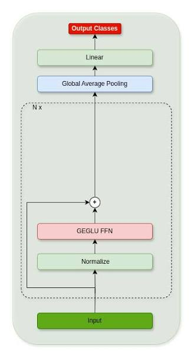
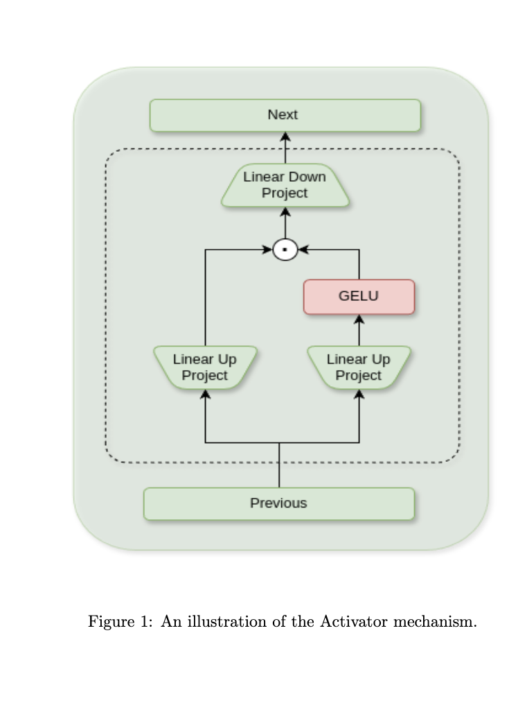

# Development Journal

by Taylor Turner

# MNIST 

## Baseline

Stochastic Gradient Descent
a = 0.05
epochs = 10
seed = 42 (if not specified, assume 42)
mnist: 95.65% test accuracy · 0.5 minutes · mps

> For now, I am only focused on the MNIST. Once I have achieved a perfect score on that dataset, I will move onto the next.

---

## Manual Hyperparameter Tuning

> I began by leaving the model architecture unchanged, only changing hyperparameters by hand to understand their impacts. 

### Learning Rate

**a = 0.05** (Baseline)
mnist: 95.65% test accuracy · 0.5 minutes · mps

**a = 0.01**
epochs = 10
seed = 42
mnist: 95.49% test accuracy · 0.6 minutes · mps

**a = 0.10**
epochs = 10
seed = 42
__**mnist: 96.74% test accuracy · 0.5 minutes · mps**__

**a = 0.15**
epochs = 10
seed = 42
mnist: 96.11% test accuracy · 0.5 minutes · mps

### Let's try more epochs.

**a = 0.01**
epochs = 50
seed = 42
mnist: 97.56% test accuracy · 2.5 minutes · mps

**a = 0.10**
epochs = 50
seed = 42
mnist: 98.12% test accuracy · 2.4 minutes · mps

**a = 0.15**
epochs = 50
seed = 42
mnist: 97.97% test accuracy · 2.4 minutes · mps

> We see here lots of big jumps followed by recovery. Not as good as a=0.10.

...
0.0951
0.0790
**0.5566**
0.0905
0.0786
0.0611
0.0679
0.0467
0.0431
**0.2268**
0.0558
0.0369
0.0308
0.0270
...

> At this stage I don't see much point in adding more learning rates or more epochs. They're leveling out at very low loss, but not ~100% yet. The jump to single digits happens at epoch 25 so we see diminishing returns from that point.

---

### Train accuracy check

> I realized I didn't record train accuracy so I can't compare. Let's understand how train accuracy is looking.

a=0.05
mnist: 98.12% test accuracy · 100.00% train accuracy · 2.4 minutes · mps

a=0.10
mnist: 98.10% test accuracy · 99.97% train accuracy · 2.4 minutes · mps

a=0.15
mnist: 97.97% test accuracy · 99.94% train accuracy · 2.4 minutes · mps

> We see that the baseline learning rate was perfect for this current configuration. All it truly needed was a few more epochs. Without those epochs, it looked like it needed more help than it really did. Better test and train accuracy for baseline w/ 50 epochs. Time to move on.

---

### Layer Tinkering

> After my findings with accuracy revealed that the default learning rate was a solid starting point, I'm ready to move onto layers. For this, I intend to begin first by scaling down the layers. Right now I assume the issue is we're losing valuable signal as the layer layers add nothing but noise to an ultimately simple problem. I expect to see some small number of layers, perhaps 10-15 perform the same or better.

> I am changing my epochs to 25 for speed of training.

### Current Model
a=0.5
seed=42
layers=40
epochs=25

mnist: 97.79% test accuracy · 99.70% train accuracy · 1.2 minutes · mps

> Note: Insane that we only lose 0.30% on train with 25 less epochs

others kept the same
layers=5
mnist: 97.89% test accuracy · 99.73% train accuracy · 0.3 minutes · mps

> An incredible gain! As predicted we actually see a performance increase by decreasing the layers and a gain of 1.2 minutes

Let's try 1-4 as well.

layers=1
mnist: 97.73% test accuracy · 99.06% train accuracy · 0.4 minutes · mps

layers=2
mnist: 97.77% test accuracy · 99.09% train accuracy · 0.2 minutes · mps

layers=3
mnist: 97.80% test accuracy · 99.56% train accuracy · 0.3 minutes · mps

layers=4
mnist: 97.92% test accuracy · 99.67% train accuracy · 0.9 minutes · mps

layers=5
mnist: 97.89% test accuracy · 99.73% train accuracy · 0.3 minutes · mps

> These results are pretty incredible. 5 layers was a solid guess. My initial thoughts are that we've given a lot of opportunity across five layers of 256 hidden neurons we've given a massive amount of capabity to transform the residual stream. Even still, that capacity is still making ~0.10% improvements to performance. Layers are important, but they aren't the whole story. What I am seeing as the trainings go on is that the epochs are dropping significantly faster. We're reaching single digits (0.0#) within approximately seven epochs 

> For now, let's try a few more until we see a performance regression.

layers=6
mnist: 98.03% test accuracy · 99.78% train accuracy · 0.4 minutes · mps

layers=7
mnist: 97.60% test accuracy · 99.67% train accuracy · 0.5 minutes · mps

> Regression. Let's roll with 6 layers for now. Going to try a run with 50 epochs and 6 layers.

> Depth correction (retrospective): The runs below, through the optimizer experiments and before the later depth-discovery note, probably used `depth=7` despite recording `layers=6`. I likely forgot to reset depth after the seven-layer test. Git confirms seven in the October 19 commits, but the exact change time is uncertain. Replaying the later regularized configuration reproduced 98.24% with seven blocks and 98.16% with six.

layers=6 # Probably 7; see depth note above.
epochs=50
mnist: 98.01% test accuracy · 100.00% train accuracy · 0.9 minutes · mps

...

epoch 47: train loss 0.0012

epoch 48: train loss 0.0011

epoch 49: train loss 0.0010

epoch 50: train loss 0.0010

> Zero change in the last epoch. Clearly reached the floor of this configuration. 

> 100% train and 98.01% test shows only 0.09% regression over 50 layers. Nevertheless its still a regression, we need more ways to improve performance. Something is missing and my next target is the size of the hidden layers.

### Changing Sizes

> My ideas here are to change the size of the residual stream (width) and the size of the hidden layers (hidden).

> Let's start by changing the residual stream. I don't have immediate intuition as to what it will change. At a size of 128 we're storing 128 dimensions worth of signal out of the input 768 pixels. Perhaps a smaller residual stream is equally capable, perhaps a larger residual layer will allow more signal through. If the latter is the case, I could see a case for more layers once more.

Baseline
width=128
mnist: 98.03% test accuracy · 99.78% train accuracy · 0.4 minutes · mps


layers=6 # Probably 7; see depth note above.
epochs=25
a=0.05
width=32
hidden=256

mnist: 95.92% test accuracy · 96.93% train accuracy · 0.4 minutes · mps

> Immediately slower training. Didn't reach 0.0# until epoch 18.

layers=6 # Probably 7; see depth note above.
epochs=25
a=0.05
width=256
hidden=256
mnist: 98.04% test accuracy · 99.99% train accuracy · 0.5 minutes · mps

> Recovered training speed, 6 epochs to hit 0.0#%. Incredible training accuracy but a trivial improvement in test. All we did was improve the models ability to overfit. This looks like a dead end. Let's try a 50 epoch here since I see a bit more room for training loss.


layers=6 # Probably 7; see depth note above.
epochs=50
a=0.05
width=256
hidden=256

mnist: 98.01% test accuracy · 100.00% train accuracy · 0.9 minutes · mps

> We gained an incredible -0.03%. I'd say that was just further overfitting pushing our performance worse. Having reached 100% at a low epoch, we could be in a good place for some regularization. For now, let's see what happens when we tinker with the size of the hidden layers. Perhaps reducing the models capacity will serve a similar role.

layers=6 # Probably 7; see depth note above.
epochs=50
a=0.05
width=256
hidden=512

mnist: 98.17% test accuracy · 100.00% train accuracy · 1.0 minutes · mps

> New record! 98.18 with almost no wiggle room. I forgot to turn down epochs so we've got quite a bit of training happening here. 

> We've given the model a huge amount of per-layer capacity and residual stream capacity that it has used to memorize the train accuracy but still find some generalization. At this stage I'd like to do a wild experiment then move onto regularization. The idea being we're not able to learn anything new once we've memorized training so there's no more room left to gain test accuracy.

layers=6 # Probably 7; see depth note above.
epochs=50
a=0.05
width=512
hidden=512

mnist: 98.16% test accuracy · 100.00% train accuracy · 1.1 minutes · mps

layers=6 # Probably 7; see depth note above.
epochs=50
a=0.05
width=512
hidden=1024

mnist: 98.15% test accuracy · 100.00% train accuracy · 1.4 minutes · mps

> Crazy experiments over with no real change. This is obviously a dead end. Onto Regularization.

## Regularization

### L2 Regularization

> Weight decay is a classic from ML. Let's try to force down those worthless weights and see if we can open up some capacity for the test accuracy to use.

> Implementing using simple pytorch optimizer parameter. (weight_decay=WEIGHT_DECAY)

layers=6 # Probably 7; see depth note above.
width=256
hidden=512
a=0.05
epochs=50
weight_decay=0.99

mnist: 11.35% test accuracy · 11.24% train accuracy · 1.0 minutes · mps

> Didn't learn a thing. Only moved by 0.0001 across 50 epochs. 0.99 for lamda means that 99% of the squared magnitude is allowed to affect the weight decay, so much regularization that it can't train at all.

layers=6 # Probably 7; see depth note above.
width=256
hidden=512
a=0.05
epochs=25
weight_decay=0.01

mnist: 87.79% test accuracy · 86.78% train accuracy · 0.5 minutes · mps

> Still a big decay lambda. Good to see that the theory held. Let's try suggestion from the internet, 1e-4.

layers=6 # Probably 7; see depth note above.
width=256
hidden=512
a=0.05
epochs=25
weight_decay=1e-4

mnist: 98.09% test accuracy · 99.96% train accuracy · 0.5 minutes · mps

...
epoch 22: train loss 0.0093

epoch 23: train loss 0.0077

epoch 24: train loss 0.0060

epoch 25: train loss 0.0047

> This is interesting, we're almost back where we started but we still have a little wiggle room with train accuracy. I still see some more downward motion in the loss as well. Let's try 50 epochs.

layers=6 # Probably 7; see depth note above.
width=256
hidden=512
a=0.05
epochs=50
weight_decay=1e-4

mnist: 98.24% test accuracy · 100.00% train accuracy · 1.0 minutes · mps

> The plan paid off! We closed the train accuracy to 100% again and gained 0.10 of test accuracy. There's more regularization where that came from.

layers=6 # Probably 7; see depth note above.
width=256
hidden=512
a=0.05
epochs=50
weight_decay=0.001

mnist: 97.92% test accuracy · 99.27% train accuracy · 1.0 minutes · mps

> Tried another jump in regularization and I'm starting to see a lot of oscillation. We've lost test accuracy in exchange for some train room. Let me try a smaller learning rate.

layers=6 # Probably 7; see depth note above.
width=256
hidden=512
a=0.03
epochs=50
weight_decay=0.001

mnist: 98.06% test accuracy · 99.66% train accuracy · 1.0 minutes · mps

layers=6 # Probably 7; see depth note above.
width=256
hidden=512
a=0.01
epochs=50
weight_decay=0.001

mnist: 97.97% test accuracy · 99.91% train accuracy · 1.0 minutes · mps

> a=0.03 worked. I saw oscillation happening and it predictably solved it. With 0.01 we're seeing incredibly slow training with more room for training by epoch 50. Even if there's room there, I would rather explore another path than wait for an endless training time. Especially with only 0.09% training accuracy left.

> It's not immediately clear to me where to go from here, but I'm starting to get curious about using a fresh optimizer configuration. Dropout comes to mind for more regularization as well if we need it.

## Optimizer Tuning

> We're already using SGD, I have no interest in trying classical GD due to time and probable worse performance. So, let's try just adding some momentum and see what happens.

> I also saw a parameter "dampening" which decreases the impact of the current gradient to help prevent overshooting. We can try that if we see overshoot. 

layers=6 # Probably 7; see depth note above.
width=256
hidden=512
a=0.01
epochs=50
weight_decay=0.001
momentum=0.9

mnist: 96.66% test accuracy · 98.25% train accuracy · 1.1 minutes · mps

> Well that didn't work. Let's try less.

layers=6 # Probably 7; see depth note above.
width=256
hidden=512
a=0.01
epochs=50
weight_decay=0.001
momentum=0.5

mnist: 98.00% test accuracy · 100.00% train accuracy · 1.1 minutes · mps

> Well that kinda worked. Maybe more regularization?

layers=6 # Probably 7; see depth note above.
width=256
hidden=512
a=0.01
epochs=50
weight_decay=0.005
momentum=0.5

mnist: 94.08% test accuracy · 94.67% train accuracy · 1.1 minutes · mps

> Huge overshoot. Let's try less momentum then bring in dampening. Could also try a smaller learning rate.

layers=6 # Probably 7; see depth note above.
width=256
hidden=512
batch=256
a=0.01
epochs=50
weight_decay=0.005
momentum=0.3

mnist: 96.65% test accuracy · 97.73% train accuracy · 1.1 minutes · mps

> Doing something else as a waiting move. Changing weight decay back down and turning down batch size so it must generalize more.

layers=6 # Probably 7; see depth note above.
width=256
hidden=512
batch=128
a=0.01
epochs=50
weight_decay=0.001
momentum=0.3

mnist: 96.36% test accuracy · 98.41% train accuracy · 2.0 minutes · mps

> Still oscillating. Let's bring in dampening with previous batch size and new batch size. Odd that we overfit more with smaller batches.

> https://distill.pub/2017/momentum/ This post opened my eyes. Let's experiment. Maybe our learning rate is too high? Let's try more momentum, less learning rate.

layers=6 # Probably 7; see depth note above.
width=256
hidden=512
batch=256
a=0.001
epochs=50
weight_decay=0.001
momentum=0.9

mnist: 97.76% test accuracy · 99.96% train accuracy · 1.2 minutes · mps

> Slow training, okay results. More batch to make more little jumps?

layers=6 # Probably 7; see depth note above.
width=256
hidden=512
batch=128
a=0.001
epochs=50
weight_decay=0.001
momentum=0.9

mnist: 97.85% test accuracy · 99.94% train accuracy · 2.0 minutes · mps

> Faster convergence, seeing some oscillation. 

layers=6 # Probably 7; see depth note above.
width=256
hidden=512
batch=128
a=0.0001
epochs=50
weight_decay=0.001
momentum=0.9

mnist: 97.94% test accuracy · 100.00% train accuracy · 2.9 minutes · mps

> I'm starting to think that I have focused too much on MNIST. I think it's time to accept my high score and call it. Good to move on and come back later with future findings.

> Note: at some point I set depth=7. No idea when that happens but almost every experiment has now been thrown into question. We found minimal changes but not zero.

layers=7
width=256
hidden=512
batch=256
a=0.05
epochs=50
weight_decay=0.1e-4 # accident, 0.1e-4 == 1e-5 != 1e-4

mnist: 98.22% test accuracy · 100.00% train accuracy · 1.0 minutes · mps

> I actually made a mistake, I forgot to remove the 0. before the 1 in weight_decay and I got this 98.22%. 

layers=7
width=256
hidden=512
batch=256
a=0.05
epochs=50
weight_decay=1e-4

mnist: 98.16% test accuracy · 100.00% train accuracy · 0.9 minutes · mps

layers=6
width=256
hidden=512
batch=256
a=0.05
epochs=50
weight_decay=1e-4

mnist: 98.24% test accuracy · 100.00% train accuracy · 1.0 minutes · mps

> Today in class we discussed double descent. So, I tried training MORE with what worked. 

layers=6
width=256
hidden=512
batch=256
a=0.05
epochs=500
weight_decay=1e-4

mnist: 98.32% test accuracy

> And it worked! I tried with 5000 too but that didn't work. Its performance was incredibly variable with loss so I decided to try checking whatever epoch was the winner. That epoch would have the perfect amount of training.

> Then, also building from what we did in class I decided to add data augmentation. Move the image around, blur it, brighten it, etc. 

> When I implemented augmentation, I used Codex and it made an executive decision I was initially confused by. It created a train/test/validation split. The issue it spotted and I didn't was that I was leaking information into the test set. By choosing the ideal epoch for the training set I wasn't leaving it independent as I was tuning the model to it. This was an important realization. As a competition, the flaw is that we're trying to maximize performance on data we have. Thus, it is incredibly liable to data leakage by using test to tune.

> So, continuing with validation I had it choose the best epoch for the validation set. In one run, I achieved 99.32% accuracy after 384 epochs. Just when I was thinking about switching to CIFAR, I passed the 99% barrier twice. Then I tried setting all of the activations to GELU. Slight regression so I am finally moving on to CIFAR.

# CIFAR

## Baseline (inherited from MNIST)

layers=6
width=256
hidden=512
batch=256
a=0.05
epochs=500 (keep best)
weight_decay=1e-4
activation_function (all): GELU

cifar10: 54.59% test accuracy · 99.99% train accuracy · 0.5 minutes · mps
Best epoch: 28 · validation accuracy: 56.40%

> Crazy stuff. Instantly pulls out 99.99% train accuracy? 54% test? This indicates to me that it has become so difficult to learn generalizable patterns that it learned what it could then instantly memorized. Very strange this didn't happen with MNIST. Perhaps there was more generalizable ideas here. Let's try tanh, not expecting much. At this size of network it should be pretty much interchangable. But at this overfitting I feel it's a bad idea to scale up further.

layers=6
width=256
hidden=512
batch=256
a=0.05
epochs=500 (keep best)
weight_decay=1e-4
activation_function (all): tanh

cifar10: 52.00% test accuracy · 91.51% train accuracy · 0.5 minutes · mps
Best epoch: 25 · validation accuracy: 52.84%

> Worse. Reverting. Let's try some more.

layers=6
width=256
hidden=512
batch=256
a=0.05
epochs=500 (keep best)
weight_decay=1e-4
activation_function (all): ReLU

cifar10: 52.00% test accuracy · 91.51% train accuracy · 0.5 minutes · mps
Best epoch: 25 · validation accuracy: 52.84%

> Clearly there's more to the story of CIFAR than there was with MNIST.

> I applied a shrink to the residual stream to 64. Didn't do much. Did that + shrank batch size:

cifar10: 51.78% test accuracy · 83.72% train accuracy · 0.8 minutes · mps
Best epoch: 23 · validation accuracy: 52.28%

> I made a new format so I can stop losing track of details. Tried 10x the amount of weight decay. Hurt train accuracy a lot in the long run. The strange thing that I can't get over is this ~52% accuracy. Why would the model even while hurting for train accuracy so badly remain firm on this 52%? If there was only two classes, it would be obvious that it was randomly guessing. But given ten options, it gets half of them wrong. I think we need to understand which classes its getting right and wrong.

```
Run: runs/cifar10-20261023-123652-808ffc8f
Time: 2026-10-23 12:37:37
Task: cifar10
Train accuracy:      68.53% (45000 clean examples)
Validation accuracy: 52.48% (5000 examples)
Test accuracy:       52.09% (10000 examples)
Best epoch: 10 / 30 completed (30 configured)
Training time: 0.74 minutes
All final scores use the best validation checkpoint. Train excludes the holdout.

Hyperparameters and architecture:
{
  "task": "cifar10",
  "seed": 42,
  "device": "mps",
  "epochs": 30,
  "batch_size": 128,
  "learning_rate": 0.05,
  "weight_decay": 1e-05,
  "momentum": 0.0,
  "dampening": 0,
  "optimizer": "SGD",
  "loss": "CrossEntropyLoss()",
  "learning_rate_schedule": "constant",
  "shuffle": true,
  "architecture": {
    "width": 128,
    "hidden": 128,
    "depth": 7,
    "functional_operations": [
      "relu"
    ],
    "in_features": 3072,
    "num_classes": 10,
    "normalization": [
      "LayerNorm"
    ],
    "parameters": 644362
  },
  "validation_fraction": 0.1,
  "training_examples": 45000,
  "validation_examples": 5000,
  "selection_metric": "validation_accuracy",
  "tie_break": "earliest_epoch",
  "augmentation": {
    "enabled": false
  }
}
```

Per-class accuracy

Class	Train	Validation	Test
airplane	74.83%	62.11%	61.10%
automobile	80.33%	62.38%	63.20%
bird	49.67%	35.74%	34.50%
cat	46.09%	32.70%	29.60%
deer	67.24%	45.96%	47.00%
dog	66.16%	47.93%	49.10%
frog	74.60%	57.25%	58.30%
horse	76.71%	61.48%	57.80%
ship	76.26%	64.03%	65.80%
truck	73.37%	55.34%	54.50%

> Cat is incredibly far off but we haven't learned much here. It's learning something about all of these

> I am changing the runs to use less epochs since performance is worsening on average after 10%. Likely the point at which it starts memorizing given thats where loss diverges.

Run: runs/cifar10-20261023-134752-02729c78
Time: 2026-10-23 13:48:09
Task: cifar10
Train accuracy:      68.53% (45000 clean examples)
Validation accuracy: 52.48% (5000 examples)
Test accuracy:       52.09% (10000 examples)
Best epoch: 10 / 10 completed (10 configured)
Training time: 0.29 minutes
All final scores use the best validation checkpoint. Train excludes the holdout.

Hyperparameters and architecture:
{
  "task": "cifar10",
  "seed": 42,
  "device": "mps",
  "epochs": 10,
  "batch_size": 128,
  "learning_rate": 0.05,
  "weight_decay": 1e-05,
  "momentum": 0.0,
  "dampening": 0,
  "optimizer": "SGD",
  "loss": "CrossEntropyLoss()",
  "learning_rate_schedule": "constant",
  "shuffle": true,
  "architecture": {
    "width": 128,
    "hidden": 128,
    "depth": 7,
    "functional_operations": [
      "relu"
    ],
    "in_features": 3072,
    "num_classes": 10,
    "normalization": [
      "LayerNorm"
    ],
    "parameters": 644362
  },
  "validation_fraction": 0.1,
  "training_examples": 45000,
  "validation_examples": 5000,
  "selection_metric": "validation_accuracy",
  "tie_break": "earliest_epoch",
  "augmentation": {
    "enabled": false
  }
}

| Class | Train | Validation | Test |
| --- | ---: | ---: | ---: |
| airplane | 74.83% | 62.11% | 61.10% |
| automobile | 80.33% | 62.38% | 63.20% |
| bird | 49.67% | 35.74% | 34.50% |
| cat | 46.09% | 32.70% | 29.60% |
| deer | 67.24% | 45.96% | 47.00% |
| dog | 66.16% | 47.93% | 49.10% |
| frog | 74.60% | 57.25% | 58.30% |
| horse | 76.71% | 61.48% | 57.80% |
| ship | 76.26% | 64.03% | 65.80% |
| truck | 73.37% | 55.34% | 54.50% |

> I decided to switch from SGD with weight decay to ADAMW. I saw no immediate ways forward from the previous and learned more about how ADAMW works. We will hopefully see some really nice improvements to accuracy and keep our weight decay to avoid overfitting. Turning down learning rate to match the lowerer needs of ADAMW as well. Let's see!

Run: runs/cifar10-20261024-151753-14698b08
Time: 2026-10-24 15:18:21
Task: cifar10
Train accuracy:      68.88% (45000 clean examples)
Validation accuracy: 54.36% (5000 examples)
Test accuracy:       53.32% (10000 examples)
Best epoch: 8 / 10 completed (10 configured)
Training time: 0.45 minutes
All final scores use the best validation checkpoint. Train excludes the holdout.

Hyperparameters and architecture:
{
  "task": "cifar10",
  "seed": 42,
  "device": "mps",
  "epochs": 10,
  "batch_size": 128,
  "learning_rate": 0.001,
  "weight_decay": 1e-05,
  "momentum": null,
  "dampening": null,
  "betas": [
    0.9,
    0.999
  ],
  "eps": 1e-08,
  "optimizer": "AdamW",
  "loss": "CrossEntropyLoss()",
  "learning_rate_schedule": "constant",
  "shuffle": true,
  "architecture": {
    "width": 128,
    "hidden": 128,
    "depth": 7,
    "functional_operations": [
      "relu"
    ],
    "in_features": 3072,
    "num_classes": 10,
    "normalization": [
      "LayerNorm"
    ],
    "parameters": 644362
  },
  "validation_fraction": 0.1,
  "training_examples": 45000,
  "validation_examples": 5000,
  "selection_metric": "validation_accuracy",
  "tie_break": "earliest_epoch",
  "augmentation": {
    "enabled": false
  }
}

| Class | Train | Validation | Test |
| --- | ---: | ---: | ---: |
| airplane | 75.32% | 59.21% | 61.10% |
| automobile | 75.22% | 58.02% | 58.80% |
| bird | 58.09% | 43.37% | 42.60% |
| cat | 57.93% | 42.97% | 38.70% |
| deer | 51.83% | 38.09% | 36.20% |
| dog | 55.03% | 39.46% | 41.60% |
| frog | 76.63% | 64.58% | 64.10% |
| horse | 79.37% | 65.07% | 62.20% |
| ship | 81.82% | 68.58% | 67.70% |
| truck | 77.74% | 62.61% | 60.20% |

> No magic bullet of AdamW will work it seems. Let's try data augmentaton that we learned in class.

> After adding the ability to use data augmentation on any data set, I also added a ability to preview the data. I'm theorizing that there is a connection between this 50 to 60% failure rate and the actual shape of the data. My thought is there is sixty percent of the data that's rather normal, obvious offerings, while there's 40% confounding data. For example, an image with the cat having its mouth wide open taking up five percent of it. 

Run: runs/cifar10-20261024-180552-79892e5e
Time: 2026-10-24 18:06:40
Task: cifar10
Train accuracy:      58.16% (45000 clean examples)
Validation accuracy: 55.18% (5000 examples)
Test accuracy:       54.14% (10000 examples)
Best epoch: 10 / 10 completed (10 configured)
Training time: 0.80 minutes
All final scores use the best validation checkpoint. Train excludes the holdout.

Hyperparameters and architecture:
{
  "task": "cifar10",
  "seed": 42,
  "device": "mps",
  "epochs": 10,
  "batch_size": 128,
  "learning_rate": 0.001,
  "weight_decay": 1e-05,
  "momentum": null,
  "dampening": null,
  "betas": [
    0.9,
    0.999
  ],
  "eps": 1e-08,
  "optimizer": "AdamW",
  "loss": "CrossEntropyLoss()",
  "optimizer_settings": {
    "name": "AdamW",
    "lr": 0.001,
    "weight_decay": 1e-05,
    "beta1": 0.9,
    "beta2": 0.999,
    "eps": 1e-08,
    "amsgrad": false
  },
  "optimizer_groups": [
    {
      "optimizer": "AdamW",
      "lr": 0.001,
      "betas": [
        0.9,
        0.999
      ],
      "eps": 1e-08,
      "weight_decay": 1e-05,
      "amsgrad": false,
      "maximize": false,
      "foreach": null,
      "capturable": false,
      "differentiable": false,
      "fused": null,
      "decoupled_weight_decay": true,
      "parameter_count": 644362
    }
  ],
  "learning_rate_schedule": "constant",
  "shuffle": true,
  "architecture": {
    "width": 128,
    "hidden": 128,
    "depth": 7,
    "functional_operations": [
      "relu"
    ],
    "in_features": 3072,
    "num_classes": 10,
    "normalization": [
      "LayerNorm"
    ],
    "parameters": 644362
  },
  "validation_fraction": 0.1,
  "training_examples": 45000,
  "validation_examples": 5000,
  "selection_metric": "validation_accuracy",
  "tie_break": "earliest_epoch",
  "augmentation": {
    "enabled": true,
    "default": {
      "rotation": {
        "probability": 0.25,
        "amount": 10.0
      },
      "translation": {
        "probability": 0.5,
        "amount": 4.0
      },
      "scale": {
        "probability": 0.25,
        "amount": 0.1
      },
      "shear": {
        "probability": 0.25,
        "amount": 5.0
      },
      "brightness": {
        "probability": 0.25,
        "amount": 0.1
      },
      "noise": {
        "probability": 0.25,
        "amount": 0.05
      },
      "erasing": {
        "probability": 0.25,
        "amount": 0.05
      },
      "horizontal_flip": {
        "probability": 0.5,
        "amount": 1.0
      }
    },
    "classes": {},
    "task": "cifar10"
  }
}

> Well, Overfitting decreased. Performance is bad. I'm now going to do the opposite. I'm gonna scale up the model. Let's turn up batching a little bit. Let's increase the size of the residual stream, more layers, the whole shebang until we start overfitting again. Then we'll increase the chance of augmenting the data. Hopefully if we do that in a loop enough times, we will extract all we can out of a resnet.

> I have increased the net size and dramatically increased the regularization and only seen minimal changes. Interestingly Muon had better results than AdamW. We are still seeing 80% accuracy on training by the end of 15 epochs which tells me we're not giving enough signal to avoid the problem of accuracy. 

> Let's try shrinking the residual stream. I am wondering if we're allowing too much information through which is allowing for easy memorization. This thought is driven by the earlier memorization that we're seeing. Eh the other side of that is the layer counts too. I turned them up quite a bit earlier. I'll try tinkering with both. If I increase the size of the residual stream, but leave the number of layers the same, then we are transforming a higher dimensional representation. If I decrease the number of layers and leave the residual stream the same, then we're transforming a lower dimensional representation. Ideally, we want to find the lowest dimensional representation we possibly can that can still carry enough information to determine what it is. By that logic, I'm going to leave the residual stream small and see what we can do with that. 

> Nope.  Shrinking the residual stream to the size of the input or below destroys performance. That makes sense. The images are complex enough that REDUCING the amount of information we let through sounds like a recipe for disaster.

## Happy Accident

> So I wasn't liking the results I was getting so I added a feature to roll back to previous configurations. But, apparently it was bugged. Somehow I ended up with a similar shape, but a **58%** test accuracy! That's up from 52%! Per codex:

Compared with recorded 52.09% runs:

| Setting        | 52.09%    | 58.88% |
|---|---:|---:|
| Width / hidden | 128 / 128 | 256 / 512 |
| Activation     | ReLU      | GELU |
| Batch size     | 128       | 256 |
| Weight decay   | 0.00001   | 0.0001 |
| Augmentation   | Off       | On  |

> So... I need to understand what happened here. I am going to look through each change one by one and theorize then test.

> 1. Width / hidden. I imagine that a residual stream of 128 with a hidden width of 128 was bottlenecking the model. We were seeing solid performance that could scale, I just hadn't noticed it. Let's test that theory by shrinking back down, keeping all else constant.

Run: runs/cifar10-20261024-212021-44f3ab35
Time: 2026-10-24 21:21:42
Task: cifar10
Train accuracy:      63.99% (45000 clean examples)
Validation accuracy: 57.56% (5000 examples)
Test accuracy:       56.68% (10000 examples)
Best epoch: 29 / 30 completed (30 configured)
Training time: 1.35 minutes

> Looks like we were a little bit right, but it only made a small difference. Reverting and moving to the next. 

> 2. ReLU -> GELU. I expect GELU is better because by definition it was an iteration upon ReLU. 

Run: runs/cifar10-20261024-212806-223e71d6
Time: 2026-10-24 21:29:32
Task: cifar10
Train accuracy:      71.77% (45000 clean examples)
Validation accuracy: 60.04% (5000 examples)
Test accuracy:       58.51% (10000 examples)
Best epoch: 29 / 30 completed (30 configured)
Training time: 1.43 minutes
All final scores use the best validation checkpoint. Train excludes the holdout.

> And so it was. 

> 3. Batch size being smaller in theory should help with generalization. We are making more erratic jumps that speed up gradient descent. And in the process we expect to not necessarily fall into local minima as easily. Smaller batch should realistically yield a better result. But evidence has shown that to be inconsistent. 

Run: runs/cifar10-20261024-213729-7b6a5d2b
Time: 2026-10-24 21:38:20
Task: cifar10
Train accuracy:      100.00% (45000 clean examples)
Validation accuracy: 57.38% (5000 examples)
Test accuracy:       55.77% (10000 examples)
Best epoch: 27 / 30 completed (30 configured)
Training time: 0.85 minutes
All final scores use the best validation checkpoint. Train excludes the holdout.

> Worse, not entirely unexpected. I think it's really interesting that this past run was able to achieve a hundred percent just because it had a smaller batch size. Clearly we found a better minima, just not a generalized one. 

> 4. This is what I had expected to make the biggest difference. Weight decay is a big deal, I've seen it absolutely tank performance in other trials. I've also seen it save performance during MNIST where we were a hundred percent accuracy. 

Run: runs/cifar10-20261024-215848-059027aa
Time: 2026-10-24 22:00:16
Task: cifar10
Train accuracy:      74.90% (45000 clean examples)
Validation accuracy: 60.38% (5000 examples)
Test accuracy:       59.07% (10000 examples)
Best epoch: 29 / 30 completed (30 configured)
Training time: 1.46 minutes
All final scores use the best validation checkpoint. Train excludes the holdout.

> Incredible. We've been over regularizing. Why not? Even smaller. 

Run: runs/cifar10-20261024-220725-3ec48d0c
Time: 2026-10-24 22:08:50
Task: cifar10
Train accuracy:      74.93% (45000 clean examples)
Validation accuracy: 60.36% (5000 examples)
Test accuracy:       59.11% (10000 examples)
Best epoch: 29 / 30 completed (30 configured)
Training time: 1.41 minutes
All final scores use the best validation checkpoint. Train excludes the holdout.

> It rounded to zero after I added one more. Going to leave regularization on. 

> 5. Augmentation

> Forgot to turn augmentation off, had to rerun all those experiments

### Audited reruns with augmentation off

| Configuration | Train | Validation | Test | Test difference from baseline | Saved run |
| --- | ---: | ---: | ---: | ---: | --- |
| Baseline: width 256 / hidden 512, GELU, batch 256, decay 0.0001 | 99.99% | 56.40% | 54.59% | +0.00 pp | [baseline](runs/cifar10-20261024-222752-audit-baseline/summary.txt) |
| Width / hidden: 128 / 128 | 72.83% | 51.74% | 50.29% | -4.30 pp | [width-hidden](runs/cifar10-20261024-222752-audit-width-hidden/summary.txt) |
| Activation: ReLU in blocks and head | 99.98% | 55.52% | 54.81% | +0.22 pp | [relu](runs/cifar10-20261024-222752-audit-relu/summary.txt) |
| Batch size: 128 | 100.00% | 57.38% | 55.77% | +1.18 pp | [batch-128](runs/cifar10-20261024-222752-audit-batch-128/summary.txt) |
| Weight decay: 0.00001 | 100.00% | 55.30% | 54.75% | +0.16 pp | [weight-decay-1e-5](runs/cifar10-20261024-222752-audit-weight-decay-1e-5/summary.txt) |
| Weight decay: 0 | 100.00% | 55.72% | 54.67% | +0.08 pp | [weight-decay-zero](runs/cifar10-20261024-222752-audit-weight-decay-zero/summary.txt) |

> Some more tinkering. Switched to AdamW with Adagrad and it seems the signal cap is 60%. Got a new record!

## Gating our Linear Units

> Time to experiment with some gated linear units. While it's directly supported by PyTorch, it's not supported by torch canvas. I could add the functionality, but I think it's a more interesting exploration if I just build it out of its puzzle pieces. Found this interesting paper when trying to find visuals for it before I remembered it was in the slides. https://arxiv.org/pdf/2405.15953

> The most interesting part of this paper is the scores. The vision transformer they benchmarked only got65 %. I might be approaching the boundary of what's possible without attention or convolution. That is not going to stop me. 

> I'll get to that paper's findings in time. For now I'm trying bilinear, since I think it's the most interesting. So far it's really not producing results much different than our previous layers. I think I'm going to come back to this after I've done...

## Pooling

> I'm wondering if I can create many feed forward networks. The idea being I take the32 by32 input image. Then subdivide it twice. That would then create many four by four sub images. Then run a multi-layer perceptron to create some new representation. We then apply all of those and flatten it. that becomes the new residual stream. Let's try it out. 

> Note: While attempting to figure out how to do this in PyTorch, I discovered that this is one of the fundamental pieces that go into a vision transformer, that being patch embeddings. There's apparently a model called MLP mixer that takes these patch embeddings and then disperses their information. I think that's a little odd personally, but I understand what they're going for. 

> Note2: Given that I just discovered it was Google that came up with the idea of the MLP mixer. I'm gonna take their word for it. https://arxiv.org/html/2105.01601v4

> At this stage I became uncertain whether this was allowed, but according to the instructions "creative ways of feeding images into an MLP, such as splitting an image into patches or mixing information across positions." Which to me sounds like exactly what I'm doing. I guess the hint was there the whole time. But I don't see how this differs from convolution. From what I can tell, a convolutional layer applies the same filter over everything, while this doesn't. 

> https://medium.com/@benjybo7/7-pytorch-pool-methods-you-should-be-using-495eb00325d6
> Another interesting page. Specifically number three with average global pooling. Avoiding overfitting sounds great. And I saw that method come up during the Google paper as well. 




> This just seems so pleasant. 

> Jumping ahead in time a bit here. I tinkered with designs from a few papers, not quite fully implementing them but testing fragments instead. Especially the activator design above. I learned that the definition of a transformer is rather loose and doesn't actually require the model to have attention! In fact, mixing pools is considered similar. Conceptually it makes sense, in fact I bet a similar attention is learned in a more opaque way.

> In my experiments, I never saw an improvement and I started looking into pooling. This was the point my mind was blown as I now have a deep understanding of how convolutional neural networks work. And further, I independently thought my way through various pooling methods. I mentioned one before but even brand new architectures from Google are exploring using new and exciting pooling techniques even within the layers. 

> At this point I added dropout to the output of the layer so it would have a 10% chance of setting a value of the input to zero. Intuitively this makes sense. We randomly are tossing out information and asking the model to still answer the question. There's some interesting probabilities here:

- Dropped at all seven layers: 0.1^7 = 0.0000001.
- Survives all seven masks: 0.9^7 ≈ 47.8%.

> These indicate the model is seeing a lot of information most of the time, so it shouldn't overregularize. Worth tinkering with the amount of dropout. If we used 0.15 instead of 0.15, we would see only 32% probability of making it through ever layer unchanged.

### Rolling 2×2 window MLP

The first [rolling-window run](runs/cifar10-20261026-215237-2ac3a7b3/summary.txt) reached 55.54% clean training, 49.98% validation, and 48.27% test accuracy. [Widening the windows and classifier](runs/cifar10-20261026-221344-5d653ac6/summary.txt) raised those scores to 71.35%, 60.80%, and 59.15%.

The [ImageNet32 run](runs/imagenet32-20261027-000850-1c570f4f/summary.txt) with the same rolling-window model reached 26.43% clean training, 20.49% validation, and 18.496% test accuracy at selected epoch 10 of 10 after 62.0 minutes, with [leaderboard submission confirmed](runs/imagenet32-20261027-000850-1c570f4f/leaderboard-submission.json). Validation accuracy was still rising and both losses were falling at the cutoff; longer training is the next experiment.

> The above was written by my agent, but I assure you the two by two rolling window was an idea I came up with. Though I've since learned I was certainly not the first. I could not believe the incredible jump in performance. It truly is the case that convolutional style approaches are incedible. 

### Dataset notebooks

MNIST, CIFAR-10, and ImageNet32 now have separate notebooks, each starting from its highest-validation completed run. Their 112 saved configurations and metrics are preserved by dataset, and loading settings in one notebook leaves the others alone.

### Extra residual block before final reduction — 2026-10-28

The [extra-block run](outputs/pre-reduction-experiment/README.md) used the same seed, split and recipe as the baseline.

| Result | Baseline | Extra block |
| --- | ---: | ---: |
| Best ImageNet32 validation accuracy | 22.0222% | 21.1067% |
| Selected epoch / completed epochs | 23 / 25 | 25 / 25 |
| Training time (minutes) | 21.81 | 23.52 |
| Accuracy change from baseline (percentage points) | — | -0.9156 |

Its best accuracy and lowest validation loss both occurred at the cutoff. No test evaluation or default change.

### Original ImageNet32 baseline recovery — 2026-10-28

Recovered the missing measurement using the instructor’s unchanged baseline and harness.

| Measure | Result |
| --- | ---: |
| Test accuracy | 6.766% |
| Training time | 15.42 minutes |
| Epochs | 10 |
| Training loss, first → last epoch | 6.4107 → 5.3584 |

[Saved run `imagenet32-originalbaseline-20261028-s0`](outputs/original-baseline-evaluation/README.md).

# Planning

> Everything below this point is ideas and planning, not necessarily implemented.

### Dropout with bootstrapping

### Oscillation detection and mean.
